# 3. Print and assemble

The house is printed from 84 STL files in `hardware/stl/` (version 8), released under CC BY 4.0. Each file name starts with a number from 01 to 59, in the order of assembly, and **the same number is engraved on the printed part**: on the inside face of the walls, near the bottom edge, and on the underside of the platforms. Identical parts share a number (for example the fourteen keys `07_Chiave_01` to `07_Chiave_14`, or the pole segments `20_Palo_2` to `20_Palo_4`).

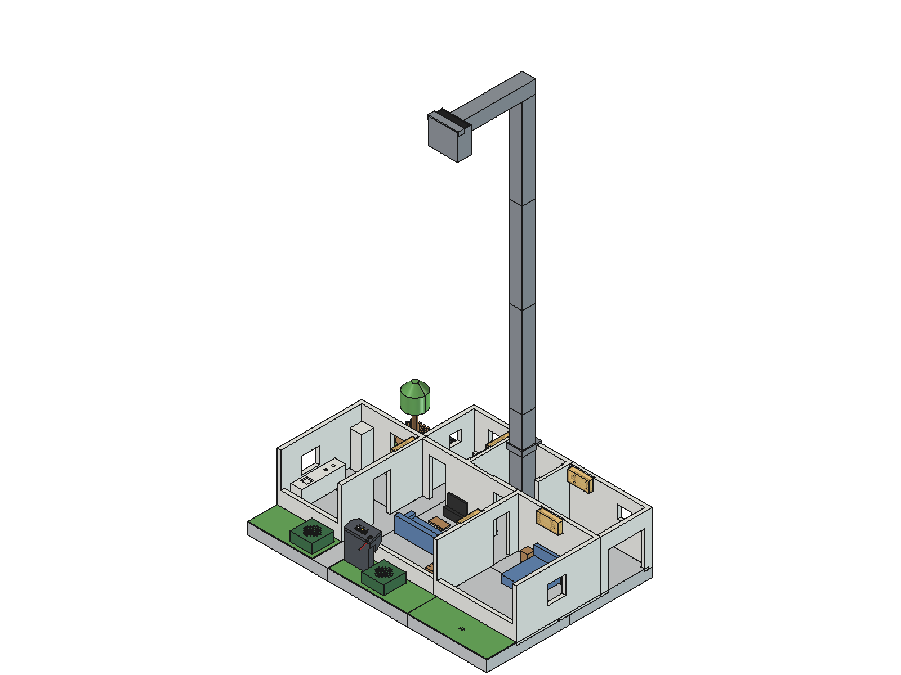

The file names are in Italian. A few words help: *Pedana* platform, *Chiave* key, *Staffa* bracket, *Scheda Audio* audio board, *Fermacavo* cable clip, *Parete* wall, *Fac* facade, *Sx* left, *Dx* right, *Palo* pole, *Collare* collar, *Braccio* arm, *Fermo* retainer, *Placca* plate, *Scocca* shell, *Tasto* button, *Coperchio* lid, *Cappucci* caps, *Credenza* sideboard, *Griglia* barbecue, *Basetta* base, *Albero* tree, *Chioma* canopy, *Tronco* trunk, *Panca* bench, *Staccionata* fence, *Fioriera* planter, *Cassa* speaker, *Prato* lawn, *Vialetto* driveway, *Arredo* furniture.

In this guide, **front** is the driveway side, where visitors stand, and **left** and **right** are seen from the front: the kitchen and the garden are on the left, the bedroom and the garage on the right. The repository contains the STL files only, without slicer profiles. The colour in the tables is the one meant for printing.

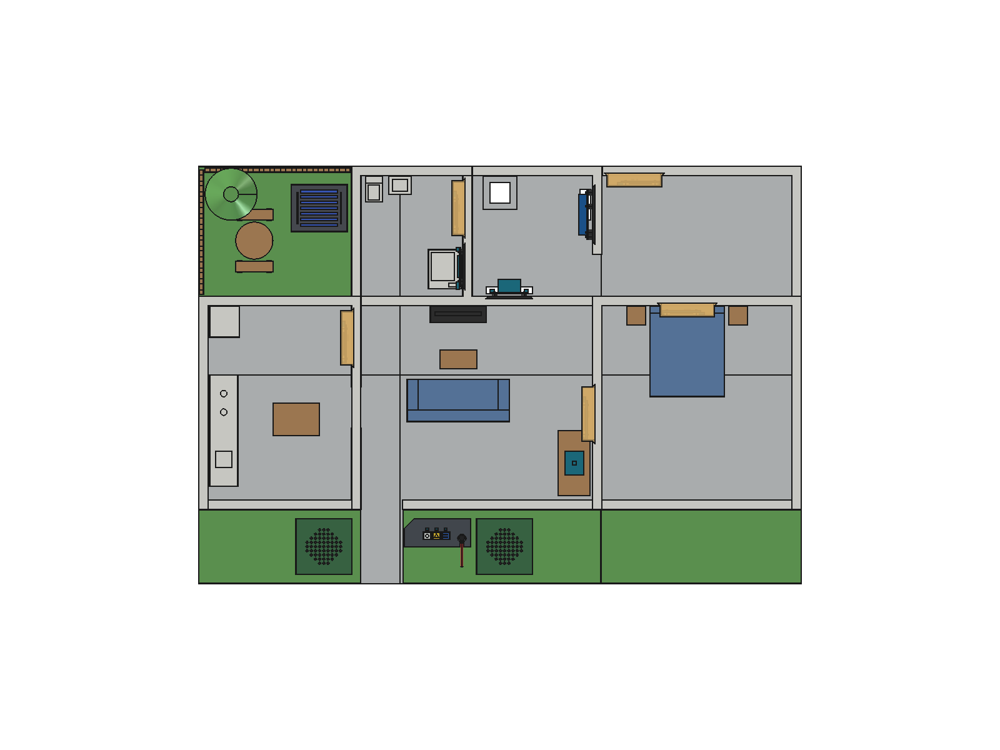

## The parts

### Base

| No. | File | Part | Colour |
|---|---|---|---|
| 01–06 | `01_Pedana_A1` … `06_Pedana_B3` | the six platforms that make the base (650 × 450 mm with the driveway), in two rows of three. Under the two planters platforms 1 and 2 are open (a 2 mm rim is left): the speakers go in from below. Platform 2 holds the socket of the totem, with the hole for the plug of the lavalier microphone | light grey |
| 07 | `07_Chiave_01` … `07_Chiave_14` | fourteen bow-tie keys that lock the platforms together from below | any |
| 08 | `08_Staffa_Revodok_1`, `_2` | two brackets that hold the UGREEN Revodok USB-C hub in its pocket under the base | any |
| 09 | `09_Staffa_Scheda_Audio_1`, `_2` | two brackets that hold the USB audio board under platform 2 (made for a 60 × 22 × 12 mm board) | any |
| 10 | `10_Fermacavo_1`, `_2` | two cable clips under platform 2 for the speaker cables (a bundle up to 8 mm) | any |

### Walls

The walls stand 135 mm above the floor; the facades of kitchen, living room and bedroom are 46 mm tall, so the camera can look into the front rooms. Walls that touch along a whole face are joined into one part, printed standing (all within 250 mm); doors and windows bridge, the garage gate (100 mm) is printed with supports.

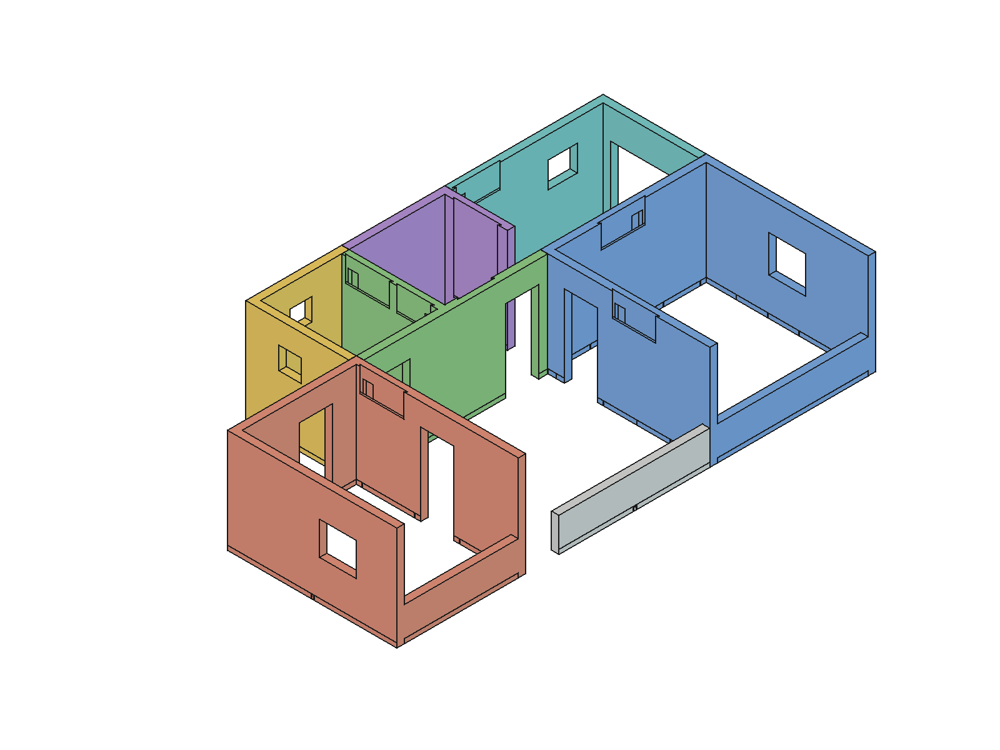

| No. | File | Walls | Colour |
|---|---|---|---|
| 11 | `11_Parete_Cucina` | the closed kitchen: left outer wall, wall to the garden (with the garden door), wall to the living room (with a door and the kitchen light) and facade | white |
| 12 | `12_Parete_Camera` | the closed bedroom: right outer wall, wall to the garage (with the bedroom light), wall to the living room (with a door and the living room light) and facade | white |
| 13 | `13_Parete_Bagno_Tecnico` | the T-shaped front of bathroom and utility room: the walls to the living room, each with a door, and the one between bathroom and utility room (bathroom light and Thermo). It is 249.5 mm wide: print it without a brim | white |
| 14 | `14_Parete_Bagno` | back wall of the bathroom and wall between garden and bathroom | white |
| 15 | `15_Parete_Tecnico` | back wall of the utility room and wall between utility room and garage | white |
| 16 | `16_Parete_Garage` | back wall of the garage (garage light) and right outer wall, with the garage gate | white |
| 17 | `17_Parete_Fac_Soggiorno` | living room facade; the gap between the kitchen and this facade is the front door | white |

### Camera pole

| No. | File | Part | Colour |
|---|---|---|---|
| 18 | `18_Palo_1` | bottom segment of the pole, rising from the utility room | grey |
| 19 | `19_Collare_Palo` | collar around the pole, at the height of the wall tops | grey |
| 20 | `20_Palo_2`, `_3`, `_4` | the upper segments of the pole, with a 20 × 20 mm window for the USB cable of the camera | grey |
| 21 | `21_Braccio_Camera` | the arm at the top, ending in the camera cradle; the cable goes from the pole into the arm | grey |
| 22 | `22_Fermo_Camera` | the retainer that holds the Logitech C270 in the cradle | grey |

### Electronics plates

| No. | File | Holds | Colour |
|---|---|---|---|
| 23 | `23_Placca_UNO_Q` | the Arduino UNO Q, pressed onto four pins, no screws | black |
| 24 | `24_Placca_Hub`, `24_Placca_Relay` | the Modulino Hub and the Modulino Latch Relay | black |
| 25 | `25_Placca_Thermo_Bagno` | the bathroom Thermo | black |
| 33 | `33_Credenza_Termostato` | the living room sideboard, with the thermostat Thermo on top | wood |
| 34 | `34_Placca_Termostato` | the plate of the thermostat Thermo, inside the sideboard | black |

### Lights

| No. | File | Room | Colour |
|---|---|---|---|
| 26 | `26_Applique_Pixels_Bagno`, `_Camera`, `_Cucina`, `_Soggiorno` | wall lights that hold a Modulino Pixels in bathroom, bedroom, kitchen and living room | translucent |
| 27 | `27_Applique_Pixels_Garage` | garage wall light | translucent |

### Intercom totem and speakers

| No. | File | Part | Colour |
|---|---|---|---|
| 28 | `28_Totem_Scocca` | the shell of the intercom totem on the driveway | anthracite |
| 29–31 | `29_Totem_Tasto_A`, `30_Totem_Tasto_B`, `31_Totem_Tasto_C` | the three buttons of the totem | white, yellow, blue |
| 32 | `32_Totem_Coperchio_Cappucci` | the lid of the totem with the button caps: the Buttons module clips onto its pins | anthracite |
| 44 | `44_Fioriera_Cassa_Sx`, `_Dx` | the two planters that cover the speakers, left and right of the totem, with a groove for the cable | dark green |

### Garden and outdoors

| No. | File | Part | Colour |
|---|---|---|---|
| 35 | `35_Griglia_Barbecue` | the barbecue; the fan goes inside | brick |
| 36 | `36_Basetta_Barbecue` | the base of the barbecue | translucent orange |
| 37 | `37_Griglia_Coperchio` | the lid of the barbecue | anthracite |
| 38, 39 | `38_Albero_Tronco`, `39_Albero_Chioma` | tree trunk and canopy | dark wood, green |
| 40 | `40_Tavolo_Giardino` | garden table | wood |
| 41 | `41_Panca_Giardino_1`, `_2` | two benches | wood |
| 42, 43 | `42_Staccionata_Sx`, `43_Staccionata_Retro` | fences on the left and at the back of the garden | wood |
| 45 | `45_Prato_Giardino` | garden lawn | green |
| 46–48 | `46_Prato_Vialetto_Sx`, `47_…_Centro`, `48_…_Dx` | the three driveway lawns | green |

### Furniture

| No. | File | Room | Colour |
|---|---|---|---|
| 49 | `49_Arredo_Cucina_Bancone` | kitchen counter | white |
| 50 | `50_Arredo_Cucina_Frigo` | fridge | white |
| 51 | `51_Arredo_Cucina_Tavolo` | kitchen table | wood |
| 52 | `52_Arredo_Divano` | living room sofa | fabric |
| 53 | `53_Arredo_Tavolino` | coffee table | wood |
| 54 | `54_Arredo_Mobile_TV` | TV unit | black |
| 55 | `55_Arredo_Letto` | bed | fabric |
| 56 | `56_Arredo_Comodino_Sx`, `_Dx` | bedside tables | wood |
| 57 | `57_Arredo_Bagno_WC` | WC | white |
| 58 | `58_Arredo_Bagno_Lavabo` | washbasin | white |
| 59 | `59_Arredo_Bagno_Doccia` | shower | white |

## Colours

The recognition compares every image with a picture of the empty house, so it does not need particular colours for walls or furniture. What matters is the contrast of what moves: a figurine whose colour is very close to the grey floor, to the walls or to the lawns is hard to see, and the house warns about it when you register it (see [chapter 7](07-recognition-and-identities.md#warnings)).

The web app draws the plan with the reference colours stored in `data/house.json`: white for counter, fridge, toilet and sink, wood brown for tables, sideboard and nightstands, blue for sofa and bed, dark grey for the TV stand and the totem, brick red for the barbecue, green for the tree and dark green for the planters. The renders show the wall lights in a translucent material, so the Pixels can shine through.

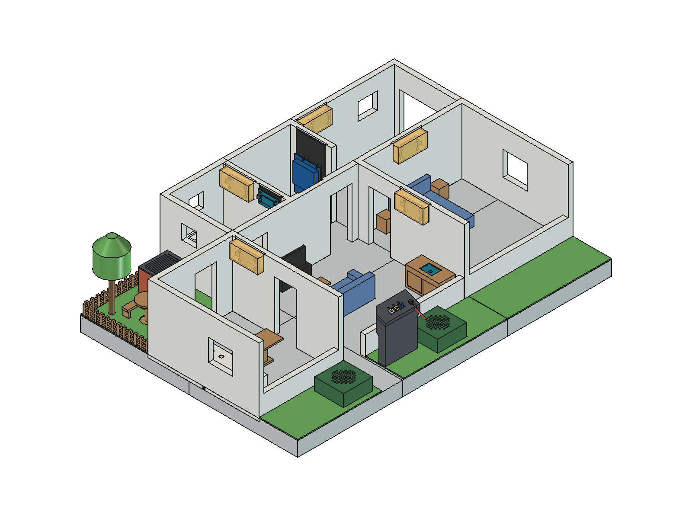

## Assembly

The renders in `docs/images/render/` show every step.

1. **Base.** Lay the six platforms upside down, check the engraved numbers, and press the fourteen keys into the bow-tie pockets across the joints. Fit the Revodok hub into its pocket and lock it with the two brackets `08`; under platform 2 mount the audio board with the brackets `09` and fix the speaker cables with the clips `10`.

   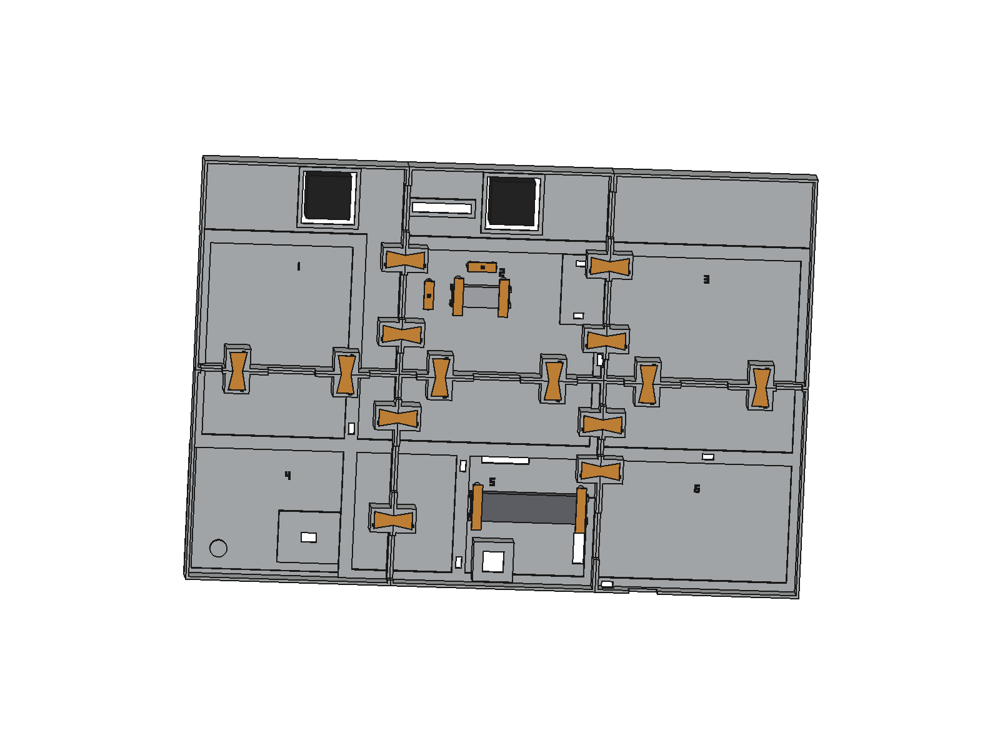

2. **Lawns.** Turn the base over and lay the garden lawn and the three driveway lawns in their places.
3. **Walls.** Insert the walls into their grooves, following the table above and the engraved numbers. The front door is the gap between the kitchen `11` and the living room facade `17`; the garage gate is in the wall `16`.
4. **Plates and lights.** Mount the modules on their plates and the Pixels in the wall lights, then hang them on the walls listed above (see [chapter 4](04-wiring.md) for which module goes where). The bathroom Thermo and the bathroom light share the wall between bathroom and utility room, in part `13`. The UNO Q presses onto the pins of its plate `23`.

   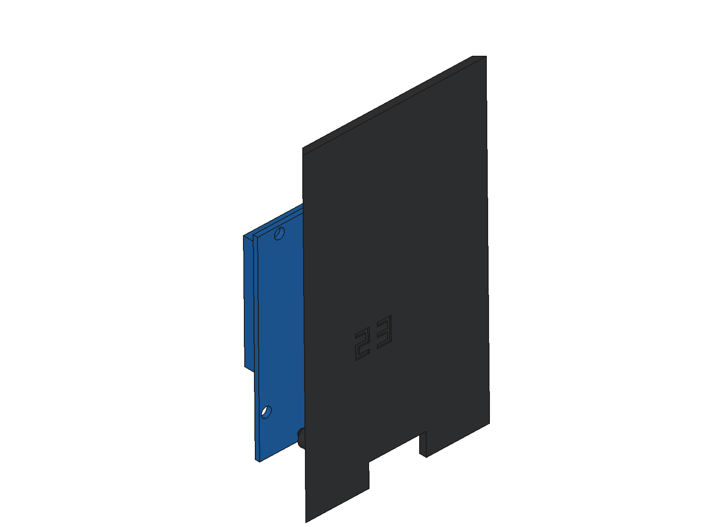

5. **Pole and camera.** Stand the bottom segment `18` in the utility room, slide the collar `19` onto it, stack the segments `20_Palo_2` to `20_Palo_4` running the USB cable of the camera through their windows, and add the arm `21`. Put the C270 in the cradle and close it with the retainer `22`. The house data puts the lens 930 mm above the floor, above the centre of the base: the calibration adapts to small differences, but the whole base must be in view.

   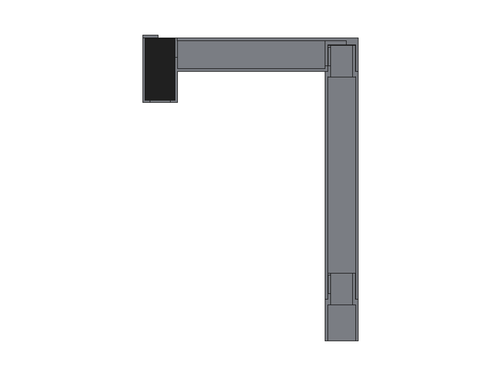

6. **Totem and speakers.** Put the three buttons `29`–`31` into the lid `32`, clip the Buttons module onto the pins of the lid and close it on the shell `28`; the plug of the lavalier microphone goes through the socket in platform 2. Slide the speakers in from below, through platforms 1 and 2, and cover them with the planters `44`.

   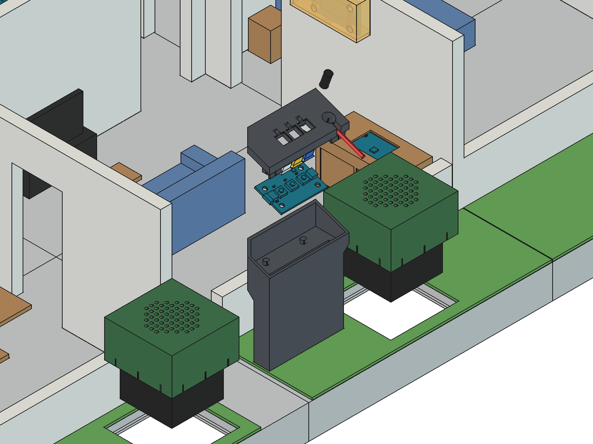

   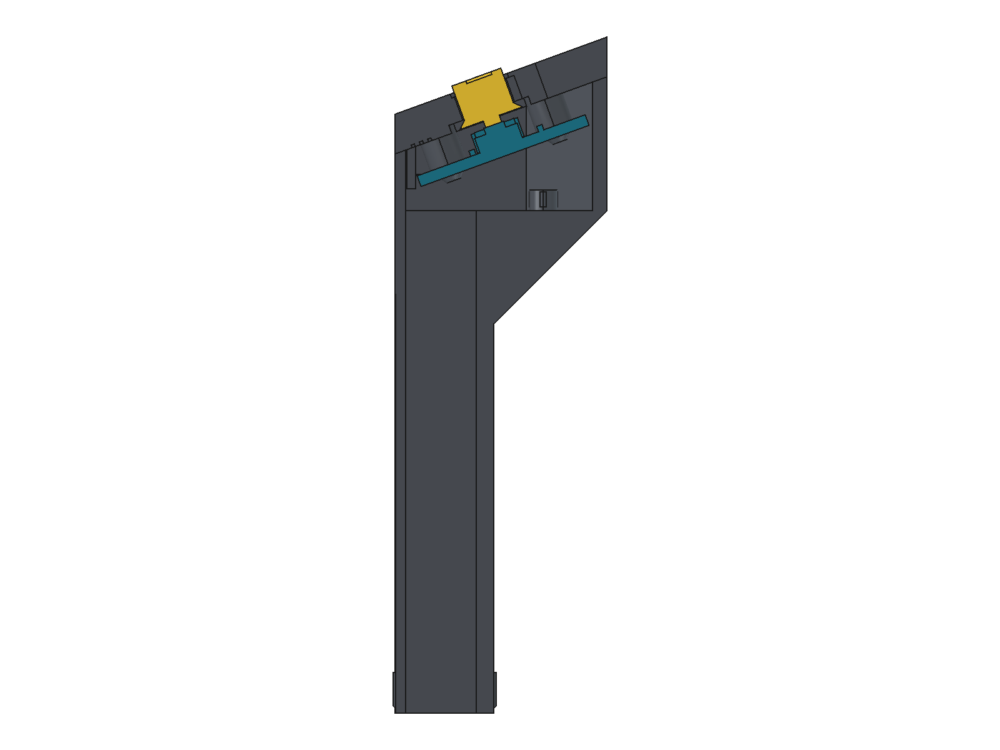
   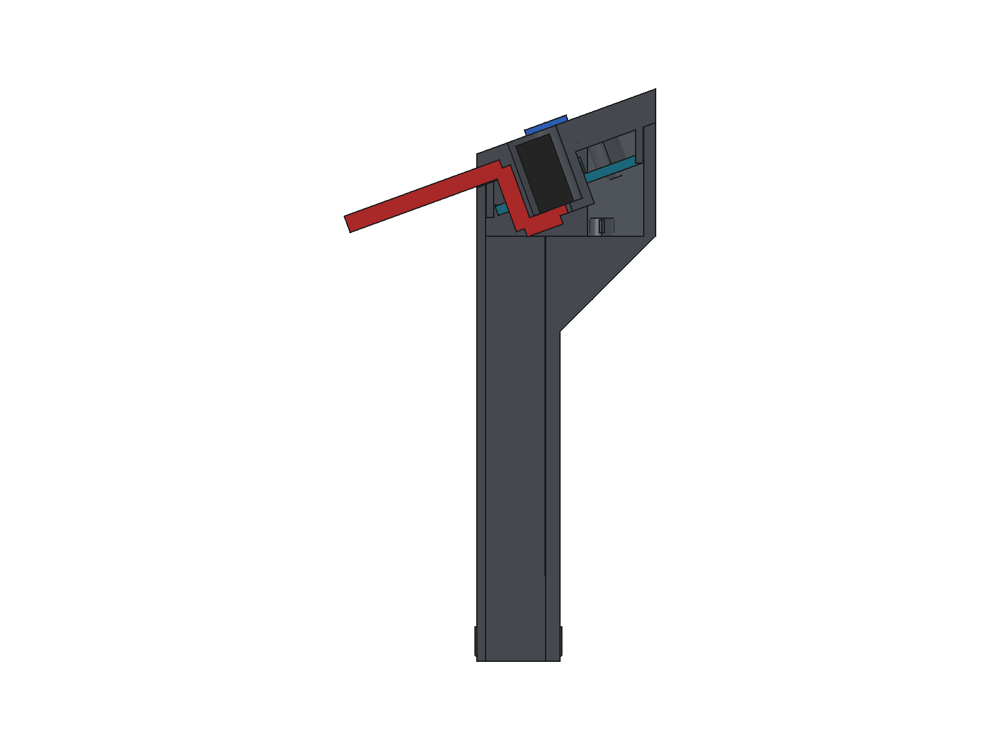

   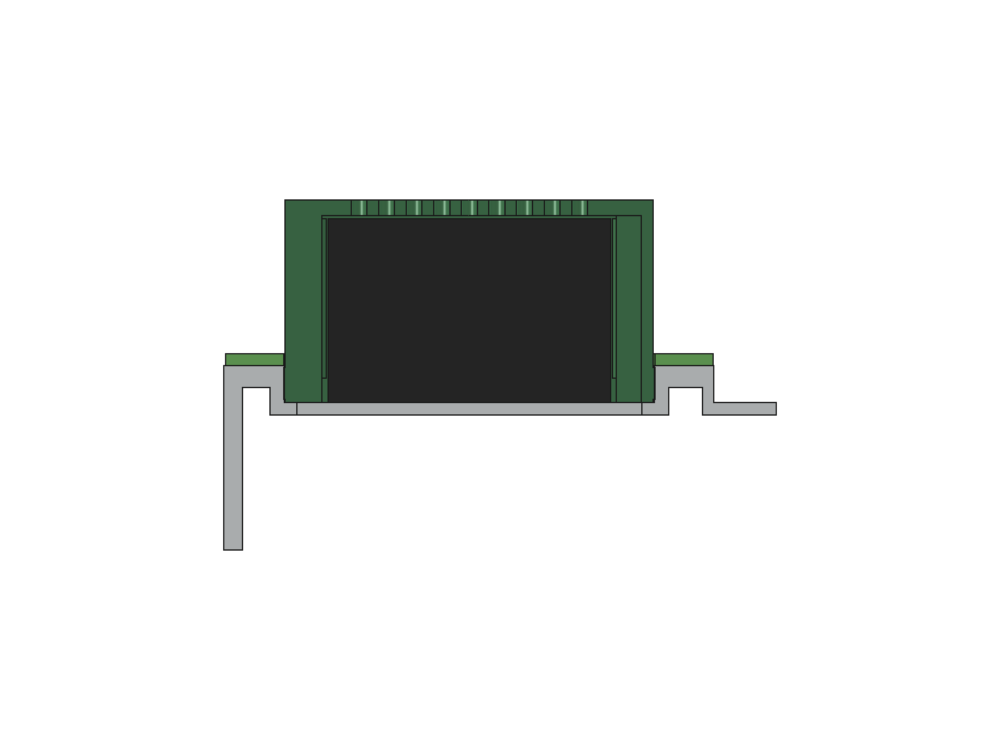

   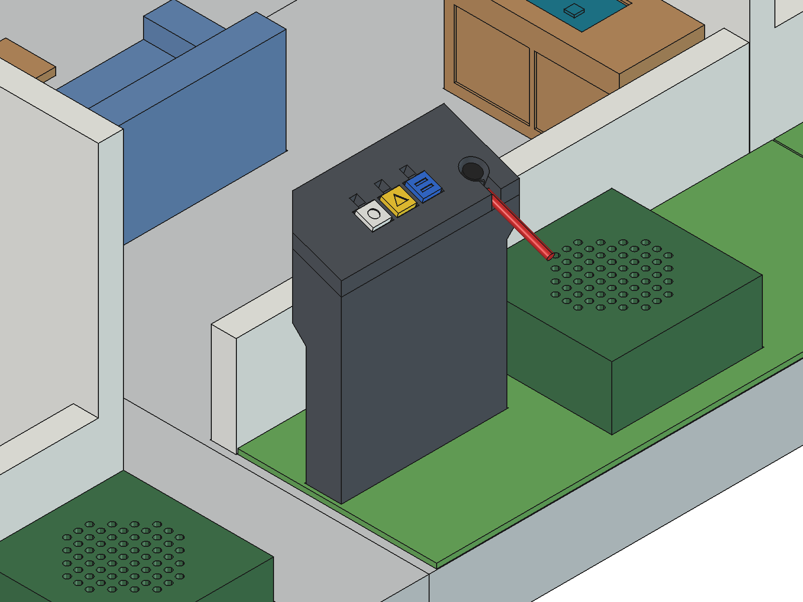

7. **Furniture and garden.** Place the furniture, the sideboard with the thermostat, the barbecue with the fan, tree, table, benches and fences.

This is how an adult sees it from the driveway, and how a child does:

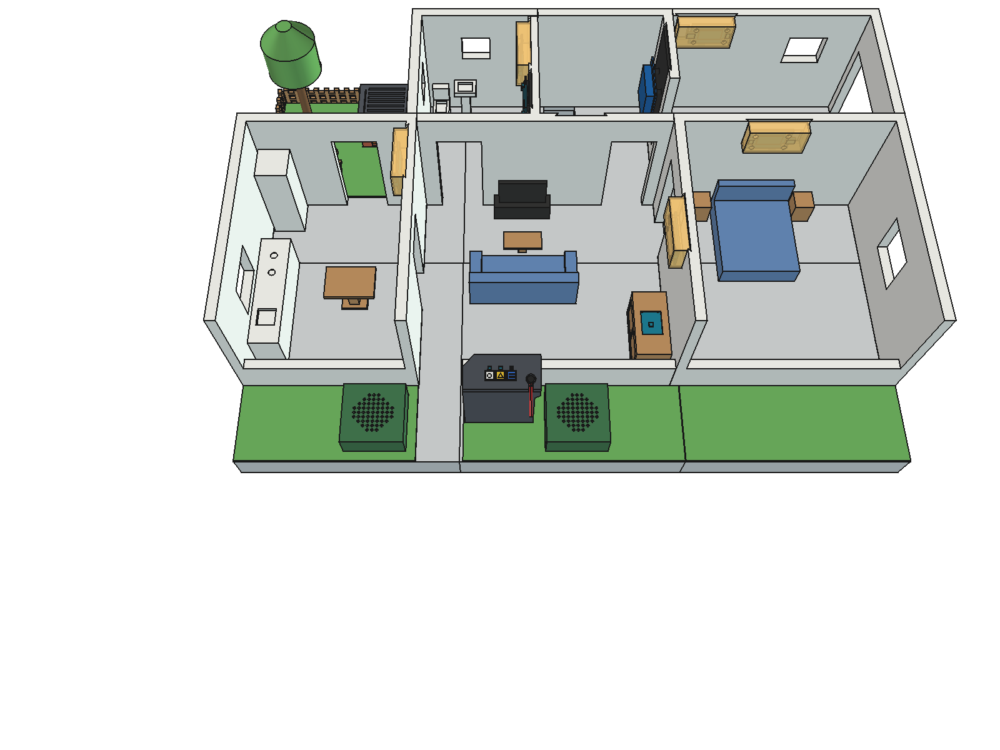
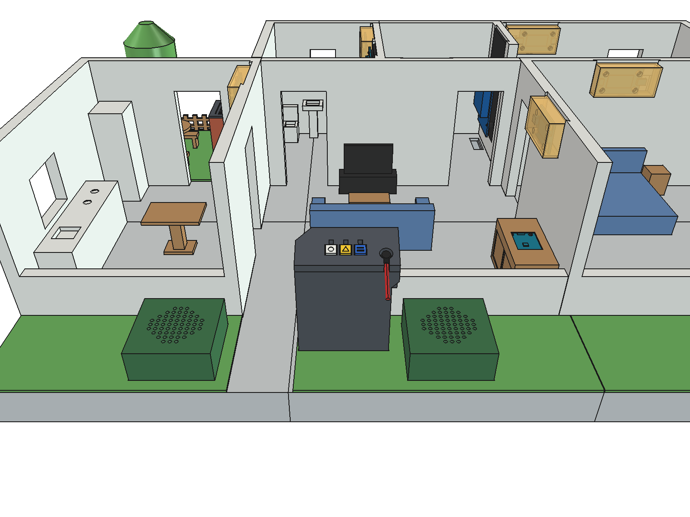

Once the house is calibrated (see [chapter 5](05-testing.md#9-camera-calibration)), the furniture must stay where it is: the house takes it as part of the empty house. If you move a piece, save the empty house again. The camera must not move either; if it gets bumped, the web app asks for a new calibration.

## Figurines, pets and the car

The figurines and the car are third-party models and are not in this repository; see the project page for links.

The house does not need a particular model, but a few numbers help to choose them. For the parallax correction the vision assumes a person about 90 mm tall (1.8 m at 1:20), a pet about 35 mm and the car about 70 mm. The car must pass through the garage gate, an opening of about 100 mm, and parks in an area of 180 × 80 mm inside the garage. Figurines work best printed in a single, clearly saturated colour that differs from the floor, the walls and the lawns.

Next: [wiring](04-wiring.md).
