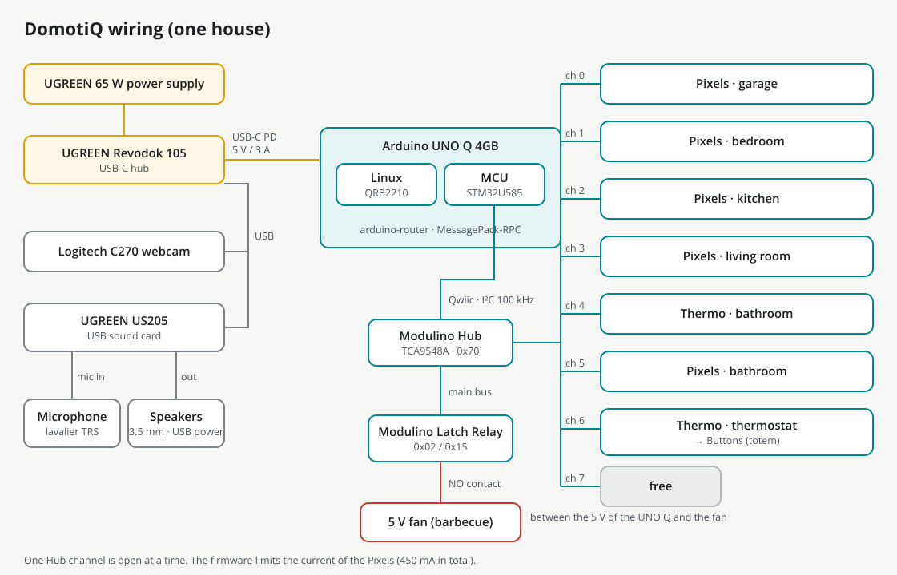

# 4. Wiring

This chapter covers everything that gets a cable: the Modulino chain on the Qwiic connector, the power of the Pixels, the relay and the barbecue fan, the audio and the webcam.

## Components

| Component | Model | Notes |
|---|---|---|
| Board | Arduino UNO Q 4GB | Debian 13 on the Qualcomm QRB2210, microcontroller STM32U585 |
| USB-C hub | UGREEN Revodok 105 | powers the UNO Q with USB Power Delivery at 5 V / 3 A; sits under the base |
| Power supply | UGREEN 65 W, 2 × USB-C + 1 × USB-A | feeds the Revodok |
| Webcam | Logitech C270 | USB ID `046d:0825` |
| Sound card | UGREEN US205 | separate headphone output and microphone input |
| Microphone | Neewer lavalier, 3.5 mm TRS | in the cap of the totem |
| Speakers | Goedch, USB powered, 3.5 mm jack | knob at maximum: the house manages the volume |
| Fan | 5 V, 40 × 40 × 10 mm | inside the barbecue |
| Modulino | 5 Pixels, 2 Thermo, 1 Buttons, 1 Distance, 1 Latch Relay, 1 Hub | |

## Overview



The same connections in text form:

```
65 W charger ──► Revodok 105 ──► UNO Q (USB-C, Power Delivery 5 V / 3 A)
                     ├── USB ── Logitech C270 (on the pole)
                     └── USB ── UGREEN US205 ── headphone out ──► speakers (3.5 mm jack)
                                            └── mic in ◄── lavalier in the totem cap

UNO Q Qwiic ──► Modulino Hub ──► Modulino Latch Relay          (main bus)
                    ├── ch 0 ── Pixels garage
                    ├── ch 1 ── Pixels bedroom
                    ├── ch 2 ── Pixels kitchen
                    ├── ch 3 ── Pixels living room
                    ├── ch 4 ── Thermo bathroom
                    ├── ch 5 ── Pixels bathroom
                    ├── ch 6 ── Thermo sideboard ──► Buttons ──► Distance
                    └── ch 7 ── free

UNO Q 5 V ──► Latch Relay contact (normally open) ──► fan ──► GND
```

## The Qwiic chain

The Qwiic connector of the UNO Q is wired to the I2C4 bus of the STM32U585 (`Wire1` in the sketch): only the microcontroller sees the Modulino. Linux talks to them through the firmware, over `arduino-router`. The firmware runs the bus at 100 kHz (the board's default is 400 kHz) and writes every I2C transaction by hand, with a bounded wait and a checked result, instead of using the Modulino library.

The main bus goes from the UNO Q to the **Modulino Hub** and on to the **Latch Relay**. Every other module hangs on one channel of the Hub:

| Hub channel | Module | Where | Address (7 bit) |
|---|---|---|---|
| main bus | Modulino Hub (TCA9548A) | on its plate (`33_Placca_Hub`) | 0x70 (searched between 0x70 and 0x77) |
| main bus | Latch Relay | on its plate (`33_Placca_Relay`) | 0x02 (factory) or 0x10 |
| 0 | Pixels | garage, on the back wall | 0x36 |
| 1 | Pixels | bedroom, on the wall towards the garage | 0x36 |
| 2 | Pixels | kitchen, on the wall towards the living room | 0x36 |
| 3 | Pixels | living room, on the wall towards the bedroom | 0x36 |
| 4 | Thermo | bathroom, on the wall towards the utility room | 0x44 |
| 5 | Pixels | bathroom, on the wall towards the utility room | 0x36 |
| 6 | Thermo, then Buttons, then Distance | sideboard in the living room, then the totem on the driveway | 0x44, 0x3E, 0x29 |
| 7 | free | | |

Notes:

- **Same addresses, different channels.** The five Pixels all answer at 0x36 and the two Thermo at 0x44. That is fine: the firmware opens only one Hub channel at a time.
- **The Hub address.** The Hub answers at 0x70; the shop page says 0x71. The firmware searches the whole range 0x70–0x77 at boot, so either works.
- **The Latch Relay address.** It comes at 0x02. If it causes trouble on the bus it can be moved to 0x10 with the Modulino AddressChanger; the firmware looks at both addresses, so nothing else changes.
- **Channel 6 is a chain.** It starts at the Thermo of the sideboard in the living room and continues to the Buttons and the Distance sensor inside the totem, just outside the front of the living room. There is only one Buttons module, so no address needs changing.
- **Order of the channels.** The light numbers in the firmware follow the Hub channels: 0 garage, 1 bedroom, 2 kitchen, 3 living room, 4 bathroom (the bathroom Pixels is on channel 5 because channel 4 holds the bathroom Thermo).
- **Plugging in later.** The firmware looks for missing modules every 5 seconds, so a module connected while the house runs shows up by itself. A module counts as present only after it has answered on the bus.

### The totem

From the bottom, the totem holds the **Buttons** module and, above it, the **Distance** sensor facing the visitors; the lavalier microphone sits in the cap. Seen by the visitor, the buttons are, from the left: **Talk**, **Intercom**, **Language**. The yellow LEDs of the Buttons module sit next to the buttons, and the totem has a window for them. If the module ends up mounted the other way round, you do not need to rewire it: switch on *Buttons mounted upside down* in the staff settings (see [chapter 6](06-web-app.md#settings)).

## Power of the Pixels

Each Pixels at full white can draw up to 264 mA from the 3.3 V line of the Qwiic connector. Five of them would reach about 1.3 A, while the connector is rated for 1 A and the 2 A regulator of the UNO Q also feeds the microcontroller and the Wi-Fi. So the firmware protects the board:

- it estimates the current of every light frame (about 11 mA per colour channel of each LED at full brightness);
- when the estimate goes above the **budget, 450 mA by default**, it scales all the lights down in proportion;
- on top of that, it limits every light to a **maximum brightness of 30 %** by default.

Both values are staff settings (*Maximum brightness (%)* and *Pixels current limit (mA)*, see [chapter 6](06-web-app.md#settings)), and the house sends them to the firmware whenever they change. The defaults are deliberately cautious, since no current meter was used to measure the real draw. Before raising them, run all lights at full white at the new limits for 10 minutes and check that the bus keeps working (the module list in *Diagnostics* stays green).

## Relay and fan

The barbecue fan is a 5 V, 40 × 40 × 10 mm fan, switched by the normally open contact of the Latch Relay placed between the 5 V pin of the UNO Q and the fan:

- 5 V of the UNO Q to the common terminal of the relay contact;
- the normally open terminal to the positive (red) wire of the fan;
- the negative (black) wire of the fan to GND of the UNO Q.

Check the terminal labels printed on your module before wiring.

A latching relay keeps its position without power. So the firmware switches it **off at every start** and also whenever Linux has been silent for 30 seconds. The firmware is built in the "Immediate" start mode: it starts at power-up instead of waiting for Linux, so after a power cut during a barbecue the fan stops within milliseconds instead of running for the 40 seconds Linux needs to boot.

In normal use the fan runs for 20 seconds per barbecue (a staff setting, 5 to 120 seconds), never more than 120 seconds in a row, with a 30-second pause before the next one.

## Audio

- **Sound card.** The UGREEN US205 plugs into the Revodok. The house finds it by itself as the first USB audio card; the UNO Q's own HDMI audio is ignored.
- **Speakers.** Their 3.5 mm jack goes into the headphone output of the US205; they take power from USB. Turn their knob to the maximum and leave it there: the house sets the volume (default 70 out of 100) and it can be changed from the web app or by voice.
- **Microphone.** The Neewer lavalier (3.5 mm TRS) goes into the microphone input of the US205, and sits in the cap of the totem. It records at 16 kHz mono, only while the house is listening; the audio stays in memory and is never saved.

The house keeps a single audio output stream always open, with its own mixer for voice, music and sound effects, so the beginning of a sentence is never cut. If the card disappears or the stream stops, the house opens it again and reports it in the diagnostics.

## Webcam

The Logitech C270 sits in the cradle at the end of the camera arm, looking straight down, and plugs into the Revodok. The house finds it by name in `/dev/v4l/by-id`, because the `/dev/videoN` number changes from boot to boot. It uses 1280 × 960 when the camera offers it, otherwise 1280 × 720, and analyses the images at 640 × 480, about 10 per second.

After the calibration, exposure, white balance and gain are locked, anti-flicker is set to 50 Hz and backlight compensation is off; the house applies these settings again every 60 seconds and after every reconnection, because an unplugged camera forgets them.

## Cable runs

Plan the cable runs before closing the house: from the UNO Q and the Hub to the five wall lights, to the bathroom Thermo, to the sideboard and on to the totem, and from the relay to the barbecue in the garden. Measure them on your assembled house before buying Qwiic cables, and keep them along the walls and away from the floor areas the camera looks at.

Next: [testing and commissioning](05-testing.md).
