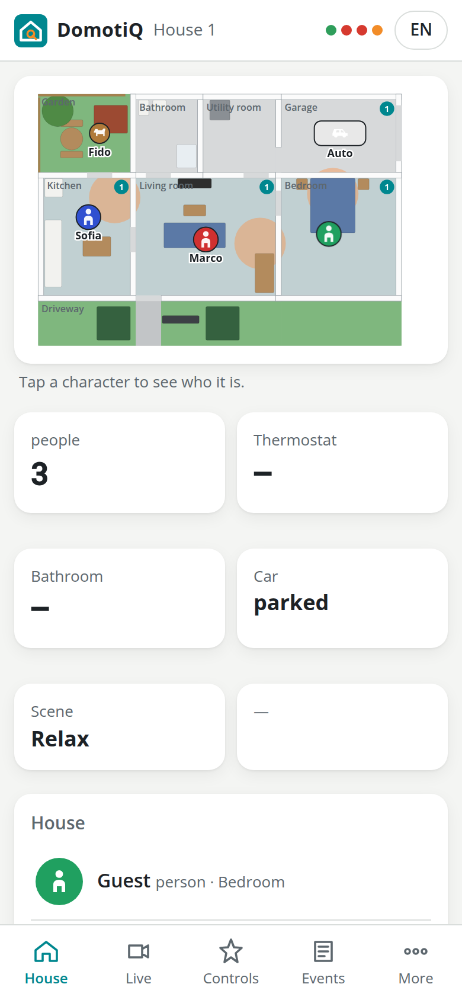
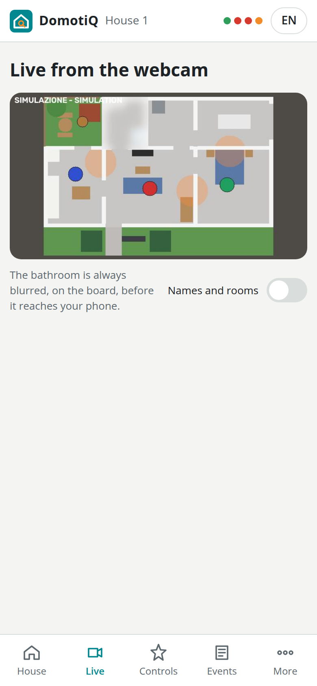
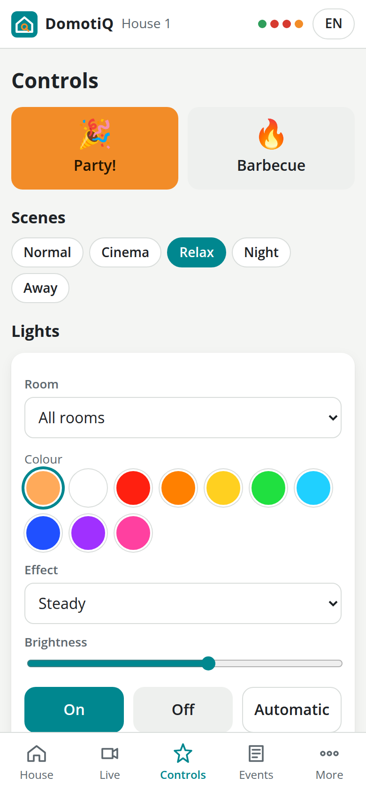
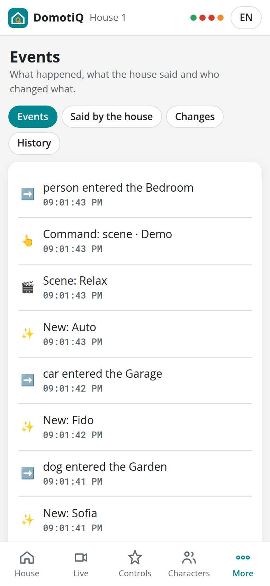
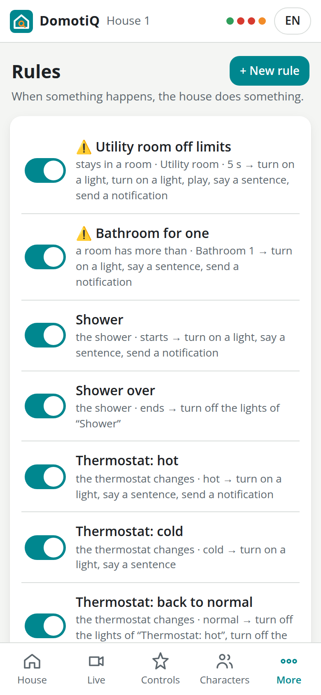
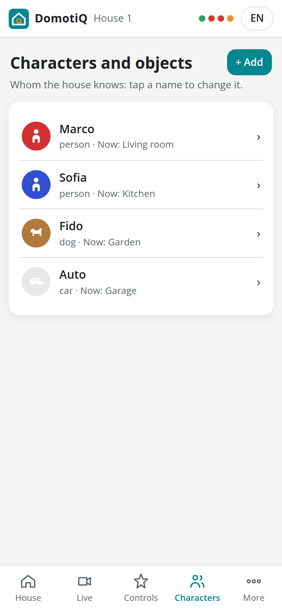
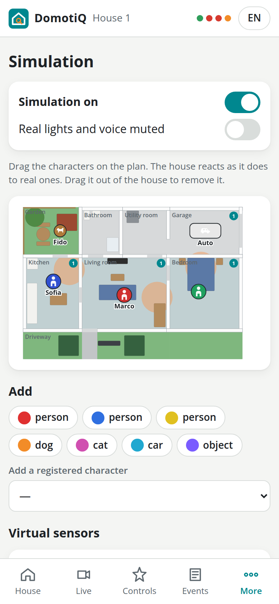
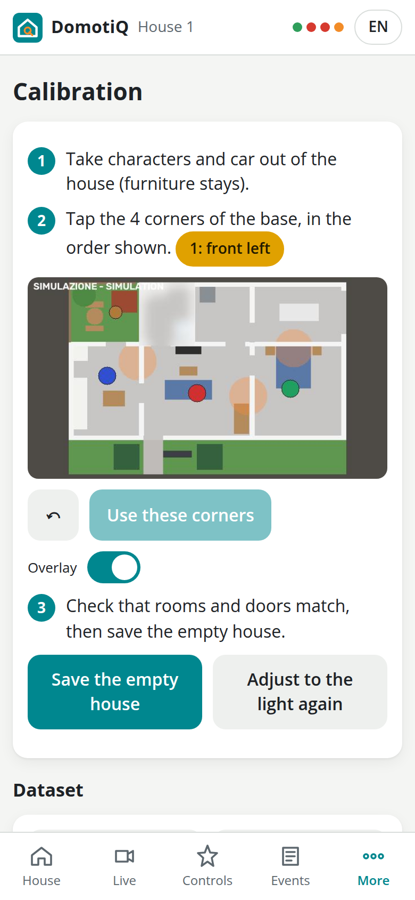
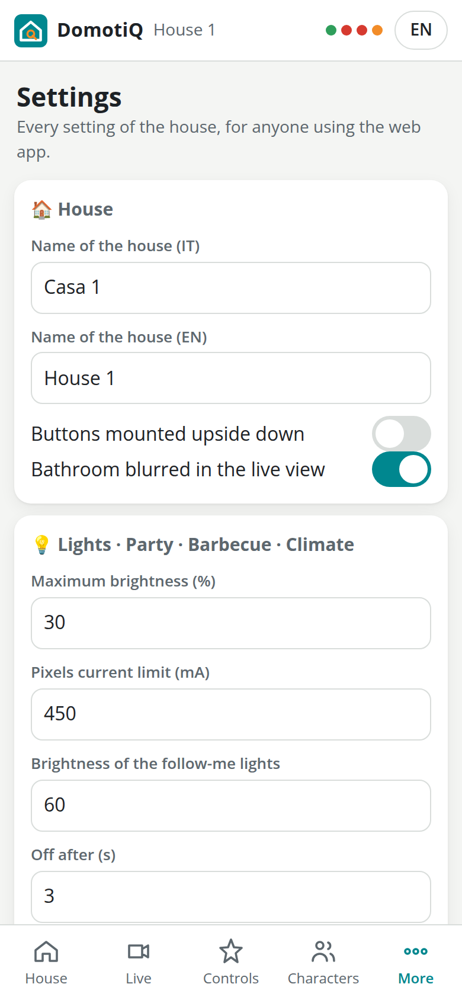
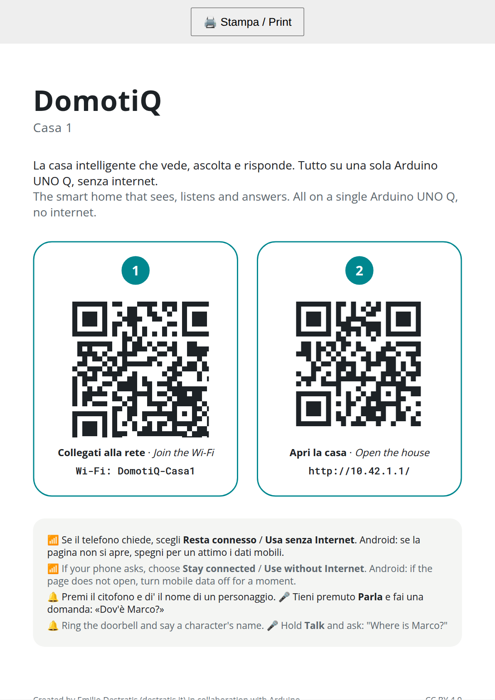

# 6. The web app

Every house serves its own web app from the board. It needs no internet and nothing to install: any phone browser on the house's Wi-Fi opens it. It is plain HTML, CSS and JavaScript with no external libraries, in Italian and English, with a light and a dark theme that follow the phone. The state of the house arrives in real time over a WebSocket, so what you see changes as soon as something moves in the house.

## Opening it

- **At the fair**: scan the two QR codes of the sign next to the house. The first joins the Wi-Fi `DomotiQ-CasaN`, the second opens `http://10.42.N.1/`. The names `http://casaN.lan/` and `http://casaN.local/` work too, but the numeric address always does.
- **In the lab**: `http://casaN.local/`, with the board on your Wi-Fi.
- Phones can add the page to the home screen; it then opens like an app.
- The first time a phone opens it, the house greets it aloud and a card asks for the name and invites the visitor to add a character (see [chapter 8](08-voice.md#talking-without-pressing-talk)).
- The web app uses plain `http://`. There are no system notifications (they would need HTTPS); photos are taken with the phone's own camera through the normal file picker, which works without HTTPS.

## Who can do what

| Everyone | Staff (PIN) |
|---|---|
| House, Live, Controls, Events | Calibration |
| Rules: create, change, switch on and off, delete | Diagnostics |
| Characters and objects: register, rename, delete | Settings, including the time, backup, the bin and power |
| Answering the questions of the house | Turning the simulation on and off |
| Printable sign, Booth display, About | Making the house say a sentence |

The **staff PIN** is chosen when the house is installed and is meant to be the same in both houses. Type it in **More → Staff PIN** and tap **Staff login**. After five wrong attempts the phone must wait a minute (*Too many attempts: wait a minute*); after ten wrong attempts from any phones in ten minutes, logins stop for everybody for a minute, then two, four, up to a quarter of an hour, so the PIN cannot be guessed by trying (staff already logged in keep working, and the PIN can always be changed on the board). A staff login lasts 12 hours on that phone, until you tap **Leave staff mode**, or until the application restarts. The staff pages show *Staff only* to everyone else.

Everyone can change the rules and the characters on purpose: this is a house for playing. Every change is recorded with the time, the phone and an optional nickname, deletions go to a bin for 24 hours, and the staff can restore them (see [Rules](09-rules.md#who-can-change-the-rules)).

## What every screen shares

- **Top bar**: the name of the house, three status dots (**Microcontroller**, **Webcam**, **Audio**: green when working, red when not; a fourth dot appears while the simulation is on), and the **IT / EN** button that switches the language of the web app on this phone only. The first time, the web app picks the language of the phone. The language the house speaks is a different setting, in **Controls**.
- **Bottom bar**: **House**, **Live**, **Controls**, **Characters** (characters and objects), **More**. **Events** is the first item of **More**. Every page scrolls to its end, above the bar.
- **Alarm banners**: while an alarm rule is active (someone in the utility room, too many people in the bathroom, an intruder), a red banner at the top of every screen names the rule, who and where; the room is outlined in red on the plan. The **✕** closes the banner on every phone: it comes back only if the alarm ends and happens again. Short notifications close with a tap.
- **Questions of the house**: when the house is unsure, a banner asks, for example "Is it Marco or Leo in the kitchen?", with one button per answer. Any phone can answer; the first answer wins and the banner disappears everywhere. The house also asks aloud and listens for the answer by itself, with no Talk button; the first answer wins, aloud or from a phone. When it asks who a newcomer is, the banner also has a field to type a new name, with the **Add** button (see [chapter 7](07-recognition-and-identities.md#a-newcomer)).
- **Subtitles**: everything the house says appears as a subtitle at the bottom of every phone, even when the house is set to *Silent*.
- **Notifications**: short messages pop up at the bottom (a character registered, the barbecue is ready, a rule's notification). Alarm notifications also vibrate the phone, where the browser allows it.
- **Connection lost**: if the phone loses the house, a banner says *Lost the connection with the house: retrying…* and the web app reconnects by itself.
- **Clock**: when the house does not know the time, the first phone that opens the web app sets it (*House time set from this phone*). Once it knows it, visitors' phones no longer touch it (one with a wrong clock would move it for everybody): the staff corrects it with **Use this phone's time**, or it can be said by voice.
- **Nickname**: the first time you change a rule or register a character, the web app asks *What's your name? (optional, shown in the log)*. You can change it in **More → Your nickname**. Each phone also has an automatic identifier.

## House



The virtual house: a plan drawn from the CAD model, with the driveway, where visitors stand, at the bottom.

- Rooms, walls, doors and furniture; each room light glows in its current colour and effect.
- The thermostat temperature (on the sideboard) and the bathroom humidity; a counter for each room with somebody in it.
- Every character with the silhouette of its kind (person, dog, cat, animal, car, object) in its colour and with its name; a **?** marks a character the house is not sure about.
- The car, flames on the barbecue while it is on, a dot at the totem when someone stands at the doorbell, red outlines for rooms with an alarm.

Below the plan, cards summarise the house: people inside, **Thermostat** (temperature, humidity, *Air conditioning on* or *Heating on*), **Bathroom** (humidity, *Shower running*), **Car** (*just arrived*, *parked*, *just left*, *not here*), **Scene**, and chips for **Party**, **Barbecue** and *Someone at the doorbell*.

At the bottom, the list of everything the house sees, with name (or *Guest* for an unknown person, *Unknown* for anything else), kind and room. Tap a character, on the plan or in the list, to open its card: photo or silhouette, kind, room, and *I'm not sure who this is* when in doubt. An unknown one has a **Register** button that starts the registration with that figurine already chosen.

## Live



*Live from the webcam*: the image of the camera, about 5 frames per second. The switch **Names and rooms** writes the name and the room over each character. On the board, before the image reaches any phone, everything around the house is blurred and, by default, the bathroom (see **Settings**).

When the camera is missing for more than a few seconds the screen says *The webcam is not connected.*, and the line goes away by itself when it is back; while the simulation is on it shows a drawing of the house marked *SIMULAZIONE - SIMULATION*.

## Controls



- **Party!**: 20 seconds of dance music composed by the house's own code, with a light show on every Pixels. There is a 30-second pause before the next party.
- **Barbecue** / **Stop the barbecue**: starts or stops the fan of the barbecue.
- **Scenes**: Normal, Cinema, Relax, Night, Away (see [chapter 9](09-rules.md#scenes)).
- **Lights**: choose a room or *All rooms*, a colour among ten, an effect (*Steady*, *Breathe*, *Blink*, *Wave*, *Rainbow*, *Sparkle*, *Fire*) and a brightness, then **On**, **Off** or **Automatic**. A light switched on here lasts two minutes, **Off** keeps the room dark for one minute, and **Automatic** gives the room back to the house at once. The switch **Lights follow people** turns the follow-me lights on or off for the whole house.
- **Voice of the house**: **Language of the house** (Italiano, English), **Talkativeness** (Silent, Normal, Chatty), **Volume**, **Ring the doorbell** (starts the intercom conversation as if the button of the totem had been pressed).
- **Make the house say** (*Staff only*): type a sentence and the house says it.

When a command cannot run right now (a party is already on, or resting), a message says *Already running or resting, try again in a moment*.

## Events



Four tabs:

- **Events**: who entered or left which room (people, animals and the car), the car, the rules that fired, notifications, thermostat and shower, scene and language changes, new characters, barbecue, party, and every command from a phone, with the nickname.
- **Said by the house**: every sentence the house said.
- **Changes**: the change log. Who (nickname or *A phone*) created, changed, deleted or restored which rule or character, changed the settings or the calibration, with the time and the phone identifier.
- **History**: for each character, the rooms it went through in the last 24 hours.

The house keeps events for 7 days and positions for 24 hours.

## More

### Rules



The list of rules, each with a switch to turn it on or off, and the **+ New rule** button. Tapping a rule opens the When / If / Then editor. Everything about rules is in [chapter 9](09-rules.md).

### Characters and objects



The list of registered characters, pets, cars and objects, with photo or silhouette, kind, and where they are now (*Now: Kitchen*, or *Not in sight*). **+ Add** starts the guided registration; tapping one opens its card, where you can change **Name**, **Kind**, **English pronunciation (optional)** and **Who they are (for the stories)** (one thing per line, as it would follow the name: *is a doctor*, *loves jazz*, *is afraid of spiders*; the house uses them in stories and answers, see [chapter 8](08-voice.md#stories-memories-and-free-questions)), or **Delete** it (it stays in the bin for 24 hours). See [chapter 7](07-recognition-and-identities.md).

### Simulation



Virtual characters dragged on the plan instead of real figurines, virtual sensors (thermostat and bathroom temperature and humidity, distance from the doorbell) and the three buttons of the totem (**Talk** is held down as on the totem). Anyone can open the page; turning the simulation on or off needs the staff PIN. **Real lights and voice muted** keeps the real house quiet while you try. While the simulation is on, the house ignores the webcam. Drag a virtual character out of the house to remove it.

### Calibration



*Staff only.* The four corners of the base (after **Use these corners** the house sets the light and saves the empty house by itself), the overlay check, **Set the light and save the empty house** and **Save the empty house only**. While the house works, a box with a spinner says what it is doing and the buttons stay locked, so an operation never starts twice; at the end the result appears (see [chapter 5](05-testing.md#9-camera-calibration)). Below are the dataset tools: **Capture**, **Burst (10)**, **Record a sequence (60 s)** and **Download the dataset** (see [chapter 7](07-recognition-and-identities.md#datasets-and-recordings)).

### Diagnostics

*Staff only.* Refreshed every few seconds:

- **Board**: host name and version, uptime, CPU load and temperature, memory, free disk, number of Wi-Fi clients, clock and where its time came from, audio device, voice (speech recognition and language model), camera (device, frames per second, processing time, *not calibrated*, *moved, calibrate again*).
- **Modulino**: the state of the link with the microcontroller, the firmware protocol version, and a green or red dot for each module.
- Buttons: **I2C scan** (addresses answering on each Hub channel), **Audio test**, **Microphone test (3 s)**, **Download the logs** (shows the last 500 lines of the application log and saves them as a file).

### Settings



*Staff only.*

- **House**: the name of the house in Italian and English; **Buttons mounted upside down**, for a totem assembled the other way round; **Bathroom blurred in the live view**, on by default.
- **Lights · Party · Barbecue · Climate**: *Maximum brightness (%)*, *Pixels current limit (mA)*, *Brightness of the follow-me lights*, *Off after (s)*, *Colour of the follow-me lights*, party *Duration (s)* (10–60), *Fan duration (s)* (5–120), *Hot: rise over the baseline (°C)*, *Shower: humidity rise (%)*. Then **Save**. Brightness and current limit go to the microcontroller at once.
- **Voice**: **Greet new phones**, **Questions to the characters (chatty mode)** and *One question every (s)* (see [chapter 8](08-voice.md#talking-without-pressing-talk)).
- **PIN · Time**: *Current PIN* and *New PIN (4-8 digits)*; a new PIN ends every other staff session. **Use this phone's time** sets the clock of the house.
- **Wi-Fi of the house**: the network name and *Wi-Fi password* (8 to 63 characters), confirmed with the *Current PIN*. **Save** writes it into the hotspot; if the hotspot is on, it restarts after a couple of seconds and every phone, the staff phone included, must join again with the new password. The printable sign updates by itself: print it again.
- **Backup**: **Download the backup** (a zip with rules, characters with their photos, and settings; never the network, the house name, the PIN or the camera calibration), **Restore from a backup** (replaces rules, characters and settings), **Default rules** (replaces all rules with the ones the house started with).
- **Bin**: rules and characters deleted in the last 24 hours, each with **Restore**.
- **System**: **Restart the app**, **Reboot the board**, **Power off the board**, each after *Are you sure?*.

### Printable sign



An A4 portrait page, ready to print, with the name of the house and two QR codes: **1 Join the Wi-Fi** (with SSID and password written below) and **2 Open the house** (with the address). A note in Italian and English explains what to do if the phone complains about the missing internet, and how to use the buttons of the totem. It opens at `/sign`.

### Booth display

`/board`: the plan, the live view, the last sentence said and the latest events, for a monitor or a tablet at the stand. It has no controls.

### About

What the project is, the credit line, and the licences of voices and models.

## Trying the web app on a PC

The whole house runs on a PC in simulation, without any hardware. From a clone of the repository:

```bash
python3 -m venv .venv
.venv/bin/pip install -r requirements.txt
PYTHONPATH=src .venv/bin/python -m domotiq --simulate
```

Then open `http://localhost:8080/`. The house keeps its data in `var/` inside the repository folder. Until a PIN is set, the staff PIN is `0000`; on the board the installer always sets one.

## For makers: the API

| Method and path | Use |
|---|---|
| `GET /api/state` | the complete state |
| `WS /ws` | the complete state on connection, then every change, questions and subtitles |
| `GET /api/stream` | live view (MJPEG) |
| `GET/POST/PUT/DELETE /api/rules` | rules |
| `GET/PUT/DELETE /api/identities` | characters |
| `POST /api/commands/{name}` | party, grill, grill_stop, scene, light, lights_off, lights_auto, language, verbosity, volume, follow, intercom, say |
| `POST /api/confirm/{id}` | answer a question of the house |
| `POST /api/time` | time from a phone |
| `POST /api/staff/login` | PIN to session token |
| `GET /api/events` | events |

Next: [recognition and identities](07-recognition-and-identities.md).
