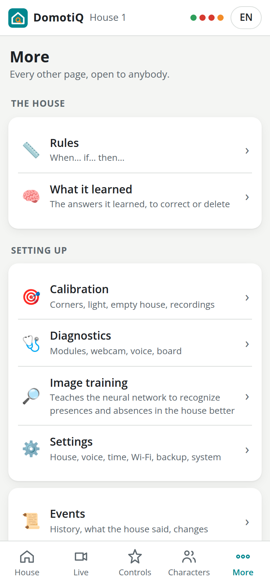

# 6. The web app

The house serves its own web app from the board. It needs no internet and nothing to install: any phone browser on the house's Wi-Fi opens it. It is plain HTML, CSS and JavaScript with no external libraries, in Italian and English, with a light and a dark theme that follow the phone. The state of the house arrives in real time over a WebSocket, so what you see changes as soon as something moves in the house.

## Opening it

- **On the Wi-Fi of the house**: on the phone choose the network `DomotiQ-Casa1` and type the Wi-Fi password (it is in the summary of the installation and in **More → Settings → Wi-Fi of the house**), then open `http://10.42.1.1/`. If the phone warns that the network has no internet, choose *Stay connected* or *Use without Internet*; on Android, if the page does not open, turn mobile data off for a moment. The names `http://casa1.lan/` and `http://casa1.local/` work too, but the numeric address always does. If you installed with `--house N`, N takes the place of 1 (see [chapter 2](02-install.md#the-hotspot)).
- **On your network**: `http://casa1.local/`, with the board on your Wi-Fi.
- Phones can add the page to the home screen; it then opens like an app.
- The first time a phone opens it, the house greets it aloud and a card asks for your name and invites you to add a character (see [chapter 8](08-voice.md#talking-without-pressing-talk)).
- The web app uses plain `http://`. There are no system notifications (they would need HTTPS); photos are taken with the phone's own camera through the normal file picker, which works without HTTPS.

## Who can do what

Anyone on the Wi-Fi of the house can do everything, with no PIN and no login: look, give commands, change rules and characters, answer the questions of the house, calibrate the camera, read the diagnostics, change the settings, download a backup, restart or power off the board. The actions that cannot be undone (restoring a backup, default rules, restart, power off, a new Wi-Fi password) ask for a confirmation first.

That is on purpose: this is a house for playing. Every change is recorded with the time, the phone and an optional nickname (**More → Events → Changes**), and deleted rules and characters wait in the bin for 24 hours (**More → Settings → Bin**; see [Rules](09-rules.md#who-can-change-the-rules)).

## What every screen shares

- **Top bar**: the name of the house, three status dots (**Microcontroller**, **Webcam**, **Audio**: green when working, red when not; a fourth dot appears while the simulation is on), and the **IT / EN** button that switches the language of the web app on this phone only. The first time, the web app picks the language of the phone. The language the house speaks is a different setting, in **Controls**.
- **Bottom bar**: **House**, **Live**, **Controls**, **Characters** (characters and objects), **More**. Every page scrolls to its end, above the bar.
- **Every page starts the same way**: the title, one line about what it is for and, right of the title, its main action (**+ Add**, **+ New rule**).
- **Notices at the top**, one colour per kind:
  - **red**: an alarm going off (someone in the utility room), with who and where, the **Switch off** button that turns the alarm off like a burglar alarm, and the **✕**; on the plan the room flashes red;
  - **amber**: a warning (too many people in the bathroom, the camera moved, the light of the camera to be set, the empty house saved in the dark, the camera seeing almost nothing or the whole house changed, the Modulino bus stuck), with the **✕**; on the plan the room is outlined in amber (see [troubleshooting](11-troubleshooting.md#camera-and-recognition));
  - **grey**: the connection with the house lost (*Lost the connection with the house: retrying…*); the web app reconnects by itself;
  - **white card with a teal edge**: a question of the house (*The house asks*). The questions come one at a time, always the latest, with how many are left after it (*one more after this one*, *2 more after this one*): once it is answered or closed, the one before comes. A name being written stays even if the page updates meanwhile;
  - **Voice registration to complete**: a registration started at the intercom or by voice in which the house sees more than one new thing; **Choose** opens the registration page, where you tap the right one on the plan.

  The **✕** closes the notice on every phone: an alarm or a warning comes back only if it ends and happens again; a closed question disappears everywhere and the house stops listening. The files of the web app load under a version that changes with every update: after an update of the house every phone reloads by itself and gets the new version.
- **Questions of the house**: when the house is unsure it asks, for example "Is it Sofia or Leo in the living room?", with one button per answer and, when more than one name is proposed, **Both** (or **All of them**): two figurines touching are a single blob for the camera. Any phone can answer; the first answer wins and the question disappears everywhere. The house also asks aloud and listens for the answer by itself, with no Talk button. When it asks who a figurine is there are also **Nothing there** and the list *Someone already known…* with the **This one** button, to pick a character the house knows but did not propose; for a newcomer, also a field to type a new name, its kind and the **Add** button (see [chapter 7](07-recognition-and-identities.md#a-newcomer)).
- **Subtitles**: everything the house says appears as a subtitle at the bottom of every phone, even when the house is set to *Silent*. While the house listens with no Talk button (a name, the answer to a question) *🎙️ The house is listening…* appears too.
- **Short messages**: they pop up at the bottom, in the same colours as the notices (a character registered, the barbecue is ready, a rule's notification, the alarm switched on or off), and close with a tap. Alarm ones also vibrate the phone, where the browser allows it.
- **Clock**: when the house does not know the time, the first phone that opens the web app sets it (*House time set from this phone*). Once it knows it, other phones no longer touch it (one with a wrong clock would move it for everybody): it is corrected from **More → Settings → Use this phone's time**, or by voice.
- **Nickname**: the first time you change a rule or register a character, the web app asks *What's your name? (optional, shown in the log)*. You can change it in **More → Your nickname**. Each phone also has an automatic identifier.

## House


*The house: who is in and what is going on, live.*

**Plan.** The virtual house, drawn from the CAD model, with the driveway, where arriving guests stand, at the bottom.

- Rooms, walls, doors and furniture; each room light glows in its current colour and effect.
- The two thermometers, the thermostat on the sideboard and the bathroom one, each with the temperature in degrees Celsius and, below, the humidity (*humidity 45%*); a counter for each room with somebody in it.
- Every character with the silhouette of its kind (person, dog, cat, animal, car, object) in its colour and with its name; a **?** marks a character the house is not sure about.
- The car, flames on the barbecue while it is on, rooms with an alarm in red and with a warning in amber.

**How the house is.** The cards: how many **people** are in the house, **Thermostat** (temperature in °C, *Humidity* in per cent, *Air conditioning on* or *Heating on*), **Bathroom** (temperature in °C, *Humidity*, *Shower running*), **Car** (*just arrived*, *parked*, *just left*, *not here*), **Scene**, and **Party · Barbecue**, which shows which of the two is on, or *Nothing going on*.

**Who is in.** The list of everything the house sees (*Nobody home* when it is empty), with name (or *Guest* for an unknown person, *Unknown* for anything else), kind and room. Tap a character, on the plan or in the list, to open its card: photo or silhouette, kind, room, and *I'm not sure who this is* when in doubt. **Who is it?** (for an unknown one) or **Someone else: change** (for one recognized wrongly) opens the list of every character and object the house knows, with the room each is in now, and below it a new name with its kind. Choosing one already known moves the name there from wherever it was, since a name is never in two places, and the house learns that look of the character even if the light changes it a lot; with a new name the character is registered with the colours the house sees. If the house sees something that is not there (a reflection, a light, a module lying around), **Not really there: remove**, after a confirmation, takes it out of the house at once: the house treats it as a mistake of the camera, forgets that spot and lets nothing be born there for a while.

**Unrecognized item.** Under the plan: tap the button, then the spot on the plan where something stands that the house does not follow (a figurine it did not see being put down, or took for the empty house). Around that spot the house takes back the empty house as it was saved, so what stands there shows again, and it follows it from then on; then it asks who it is, with the same list. If it sees nothing different from the empty house there it says so: move the item a little and try again. With the simulation on, the tap puts a virtual figurine there.

**Alarm.** At the bottom of the page, the alarm box, switched on and off like a burglar alarm:
- **On** (green shield): the alarm rules (utility room off limits, bathroom for one and the ones you mark **It is an alarm**) work;
- **Off** (grey shield): those rules stay quiet, no siren and no warnings; everything else (lights, voice, other rules) goes on as usual;
- **Alarm going off** (red edge): an alarm rule is sounding.

The **Switch off** / **Switch on** button changes it for the whole house, with a beep and a message on every phone (*Alarm off by Marco*). Switching off stops the alarms going off at once, with their lights; switching on again notices whoever is already in a watched place, as if they had just come in. The state survives a restart.

## Live


*Live from the webcam*: the image of the camera, about 5 frames per second. The switch **Names and rooms** writes the name and the room over each character. **Unrecognized item** works as on the House page, tapping the spot in the picture. On the board, before the image reaches any phone, everything around the house is blurred and, by default, the bathroom (see **Settings**).

When the camera is missing for more than a few seconds the screen says *The webcam is not connected.*, and the line goes away by itself when it is back; while the simulation is on it shows a drawing of the house marked *SIMULAZIONE - SIMULATION*.

## Controls


- **Party!**: 20 seconds of dance music composed by the house's own code, with a light show on every Pixels. While the party is on the button stays off; there is a 30-second pause before the next party.
- **Barbecue** / **Stop the barbecue**: starts or stops the fan of the barbecue.
- **Lights**: choose a room or *All rooms*; every choice reaches the house at once, with no other button. One of ten colours turns the light on, **A** gives it back to the house, the crossed circle turns it off; the effect (*Steady*, *Breathe*, *Blink*, *Wave*, *Rainbow*, *Sparkle*, *Fire*) and the brightness change the light already on. Choosing a room shows how its light is right now. A light turned on here lasts two minutes, turned off it stays dark for one minute, then the room goes back to the house.
- **Questions to the characters**: **Ask a question** makes the house ask, right away, a question to a character picked at random among those in the house, preferring what it does not know about it yet (the favourite colour, whether it loves dancing or barbecues, the favourite dish, where it comes from...). The answer is heard without Talk and kept among its facts; then the house uses it: the light in its favourite colour with "turn on Marco's favourite colour", a party if it loves dancing, the barbecue if it loves barbecues (see [chapter 8](08-voice.md#what-the-house-knows-about-the-characters)). The same button, for one character, is on its card in **Characters**. It works outside chatty mode too, but not in silent mode.
- **Voice of the house**:
  - **Language of the house** (Italiano, English);
  - **Talkativeness** (Silent, Normal, Chatty). Below it, a line explains the three levels: *Silent: the house never speaks, its answers only show as captions on the phones. Normal: it answers, gives the warnings and tells who comes in, goes out or changes room. Chatty: like Normal, plus offers, comments and questions to the characters.*;
  - **Volume**;
  - **Ring the doorbell**, which starts the intercom conversation as if the button of the totem had been pressed;
  - **Make the house say**: type a sentence and tap **Make it speak**: the house says it.

When a command cannot run right now (a party or a barbecue already on, or resting), a message says *Already running or resting, try again in a moment*.

## Events


Four tabs:

- **Events**: who entered or left which room (people, animals and the car), the car, the rules that fired, notifications, thermostat and shower, scene and language changes, new characters, barbecue, party, and every command from a phone, with the nickname.
- **Said by the house**: every sentence the house said.
- **Changes**: the change log. Who (nickname or *A phone*) created, changed, deleted or restored which rule or character, changed the settings or the calibration, with the time and the phone identifier.
- **History**: for each character, the rooms it went through in the last 24 hours.

The house keeps events for 7 days and positions for 24 hours.

## More



Every other page, in three groups, plus your nickname:

- **The house**: **Rules**, **What it learned**;
- **Setting up**: **Calibration**, **Diagnostics**, **Image training** (*Teaches the neural network to recognize presences and absences in the house better*), **Settings**;
- in a group with no title, the last two items of the menu: **Events** and **About**;
- **You**: **Your nickname**, shown in the change log.

### Rules


The list of rules, each with a switch to turn it on or off, and the **+ New rule** button. Tapping a rule opens the When / If / Then editor. Everything about rules is in [chapter 9](09-rules.md).

### What it learned

The answers the house was told, imagined or thought when it did not know (chapter 8), the latest first. For each one the page shows:
- the question, and the character, if it is about somebody;
- the answer;
- whether it was *told by somebody*, *imagined by the house* or *thought by the house*, and when;
- if it is about today or tomorrow: *valid until tomorrow*.

**Edit** opens the answer (*Correct the answer*), with the **Question** and the **Answer**.
- **Save.** The answer can be corrected, and so can a question heard wrong ("come si fa la vita" instead of "come si fa la pizza"): from then on the house says the corrected one, as if somebody had taught it. It can also be done by voice: right after a wrong answer, say "wrong" or "let me tell you".
- **Forget.** Deletes it, after a confirmation.

Every change goes into the change log.

### Characters and objects


The list of registered characters, pets, cars and objects, with photo or silhouette, kind, and where they are now (*Now: Kitchen*, or *Not in sight*). **+ Add** starts the guided registration; tapping one opens its card, where you can change **Name**, **Kind**, **English pronunciation (optional)** and **Who they are (for the stories)** (one thing per line, as it would follow the name: *is a doctor*, *loves jazz*, *is afraid of spiders*; the house uses them in stories and answers, see [chapter 8](08-voice.md#stories-memories-and-free-questions)), or **Delete** it (it stays in the bin for 24 hours). For a person or an animal there is also **Ask … a question**, which asks that very character (see **Controls**). A deleted character also leaves at once the presences in the house, the open questions and the labels of **Image training**; a rule that named it stays, marked ⚠️ *deleted character*. **Learn the look again** makes the house forget the colours, poses and size of the character, which it learns again the first time somebody says who it is: useful when the figurine is another one, for example a character painted again or replaced. See [chapter 7](07-recognition-and-identities.md).

### Calibration


The four corners of the base (after **Use these corners** the house sets the light and saves the empty house by itself), the overlay check, **Set the light and save the empty house** and **Save the empty house only**, then **Photograph in every light of the house** and **Add the light of now**, which save the empty house under different lights (see [chapter 7](07-recognition-and-identities.md#the-light-of-the-hall)). Below, a line says how many empty houses per light are saved and which one is in use; **Clear (after moving the furniture)** removes them all, after a confirmation. The empty house is not saved if the hall is too dark, nor while the house still sees figurines: it names them and asks whether to save anyway (for something that is no figurine). While the house works, a box with a spinner says what it is doing and the buttons stay locked, so an operation never starts twice; at the end the result appears (see [chapter 5](05-testing.md#9-camera-calibration)). Below are the dataset tools: **Capture**, **Burst (10)**, **Record a sequence (60 s)** and **Download the dataset** (see [chapter 7](07-recognition-and-identities.md#datasets-and-recordings)).

### Diagnostics

Refreshed every few seconds:

- **Board**: host name and version, uptime (of the board and of the app), CPU load and temperature, memory, free disk, number of devices on the Wi-Fi and of phones with the web app open, clock and where its time came from, audio device, voice (speech recognition, language model and stories), camera (device, frames per second, processing time of a picture and how it splits between segmentation, recognition and the rest, how many times it adapted to the light, *not calibrated*, *light not set*, *moved, calibrate again*), and **Light of the webcam** (gain and exposure, steps in the last hour and any pause; see [troubleshooting](11-troubleshooting.md#the-light-of-the-webcam-changes-by-itself-or-stays-at-the-limit)).
- **Modulino**: the state of the link with the microcontroller, the firmware protocol version, the state of the bus (*I2C bus free*, or which line is stuck), and a green or red dot for each module.
- Buttons: **I2C scan** (addresses answering on the main bus and on each Hub channel), **Audio test**, **Microphone test (3 s)**, **Download the logs** (shows the last 500 lines of the application log and saves them as a file).

### Image training

Teaches the neural network to recognize presences and absences in the house better. It shows the pictures still to judge one at a time, large, the latest first (among the last 600): every new presence announced, every name given and every blob refused by the network of the figurines, with how many are left (*To judge: 12*). Under the picture is what it is (*New presence: Marco*, *New name: Marco*, *Refused by the network*), when, and what the network said (*the network: Marco 87%*). One tap is enough for each: **✓ Right** (saying what it confirms, for example *Right: Marco*), **Nothing there**, or, under *Or it is:*, the button of the right character. The answer is saved by itself and the next one comes at once. **Skip (not sure)** goes to the next one without answering: that picture stays to judge next time. **↶ Back** brings back the picture before, with the answer given, to change it. A second tap right after the first does not answer the next picture too. The pictures already judged are not shown any more; when none is left, the page says *Done, nothing left to judge*. The name of a character deleted since stays in the entry, marked *(deleted)*, but has no **Right** any more: it can only be corrected. The answers become verified examples for the next training of the network (see [chapter 7](07-recognition-and-identities.md#the-network-that-knows-the-figurines)). The pictures keep the blur of what is outside the house and, if on, of the bathroom.

### Settings


- **House**: the name of the house in Italian and English; **Bathroom blurred in the live view**, on by default; **Continuous collection of pictures for the network**, off by default, and *Space for the collection (MB)*: the house keeps one picture every 5 seconds, two a second while something happens, and beyond the chosen space deletes the oldest (see [chapter 7](07-recognition-and-identities.md#the-network-that-knows-the-figurines)).
- **Party · Barbecue · Climate**: party *Duration (s)* (10–60), *Fan duration (s)* (5–120), *Hot: rise over the baseline (°C)*, *Shower: humidity rise (%)*. Then **Save**. The lights that follow people are off by default and their settings are not shown (see [chapter 9](09-rules.md#priorities-and-light-layers)); the maximum brightness and the current limit of the Pixels are fixed values (see [chapter 4](04-wiring.md#power-of-the-pixels)).
- **Voice**: **Greet new phones**, **Questions to the characters (chatty mode)** and *One question every (s)* (at least 45; see [chapter 8](08-voice.md#talking-without-pressing-talk)); **Wake up with a keyword** and *Keyword* (for example *Casa*): once the word is said, the house does what the Talk button does (see [chapter 8](08-voice.md#the-word-of-activation)). With this option the microphone stays on while the house is free, and the audio is never saved. Then **Save**. Each of the two **Save** buttons saves the **House**, **Party · Barbecue · Climate** and **Voice** cards together. On saving, below appears how the house will hear the word (*Robot 3* becomes *robot tre*; *Domotiq*, which the speech recognizer does not know, is heard as “domotica”). Any words the recognizer cannot hear in any way are listed too.
- **Time**: the time of the phone and **Use this phone's time**, which sets the clock of the house.
- **Wi-Fi of the house**: the network name and *Wi-Fi password* (8 to 63 characters). **Save**, after a confirmation, writes it into the hotspot; if the hotspot is on, it restarts after a couple of seconds and every phone, yours included, must join again with the new password. If the hotspot is not set up on the board yet, the password is saved but the hotspot does not change, and a message says so (*Password saved, but the hotspot was not changed*). Write it down: every phone that joins the network needs it.
- **Backup**: **Download the backup** (a zip with rules, characters with their photos, and settings; without the Wi-Fi, the house name and the camera settings, and never the calibration), **Restore from a backup** (choose the zip file; after *Are you sure?* it replaces rules, characters and settings), **Default rules** (replaces all rules with the ones the house started with).
- **Bin**: rules and characters deleted in the last 24 hours, each with **Restore**.
- **System**: **Restart the app**, **Reboot the board**, **Power off the board**, each after *Are you sure?*.

### Display board

It is not in the menu: open it by typing `/board` after the address of the house. It shows the plan, the live view, the last sentence said and the latest events, for a monitor or a tablet next to the house, and has no controls.

### About

What the project is, the credit line, and the licences of voices and models.

## Trying the web app on a PC

The whole house runs on a PC in simulation, without any hardware. From a clone of the repository:

```bash
python3 -m venv .venv
.venv/bin/pip install -r requirements.txt
PYTHONPATH=src .venv/bin/python -m domotiq --simulate
```

Then open `http://localhost:8080/`. The house keeps its data in `var/` inside the repository folder.

Instead of the webcam there are virtual figurines. The simulation page is not in the menu: open it with `http://localhost:8080/#/sim`. There you find:

- **Simulation on**, switched on when the house starts with `--simulate`, and **Real lights and voice muted**;
- the plan, where you drag the characters (drag one out of the house to remove it);
- **Add**: a figurine of a kind (person, dog, cat, car, object), or **Add a registered character**;
- **Virtual sensors**: temperature and humidity of the thermostat and of the bathroom;
- **Doorbell buttons**: **Talk** (hold it), **Doorbell** and **Language**.

## For makers: the API

The requests that change something can say who makes them with the headers `X-Device` (the identifier of the phone) and `X-Nickname` (the nickname, URL-encoded): they go into the change log.

| Method and path | Use |
|---|---|
| `GET /api/state` | the complete state |
| `WS /ws` | the complete state on connection, then every change, questions and subtitles |
| `GET /api/stream`, `GET /api/snapshot.jpg` | live view (MJPEG) and a single picture |
| `GET /api/events`, `GET /api/audit`, `GET /api/history/{id}` | events, change log, rooms of a character in the last 24 hours |
| `GET/POST /api/rules`, `PUT/DELETE /api/rules/{id}` | rules |
| `POST /api/rules/{id}/enabled`, `POST /api/rules/defaults` | switch a rule on or off (`{"enabled": false}`), default rules |
| `GET/POST /api/identities`, `PUT/DELETE /api/identities/{id}` | characters (`POST` with `{"name": ..., "category": ...}` creates one the house has not seen yet) |
| `POST /api/identities/{id}/forget-look` | *Learn the look again* |
| `POST /api/tracks/adopt` | *Unrecognized item*: `{"x": ..., "y": ...}` in mm on the plan, or `{"u": ..., "v": ...}` from 0 to 1 in the picture |
| `POST /api/tracks/{id}/identity`, `POST /api/tracks/{id}/dismiss` | who a presence is (`{"identity": id}`, or `{"name": ..., "category": ...}`), *Not really there: remove* |
| `POST /api/confirm/{id}` | answer a question of the house: `{"value": ...}` with the id of a character, or `{"together": [...]}` for *both*, `{"nothing": true}` for *nothing there*, `{"known": id}` for one already known, `{"name": ..., "category": ...}` for a new name |
| `POST /api/confirm/{id}/close`, `POST /api/alerts/{key}/dismiss` | close a question or a warning on every phone |
| `GET /api/knowledge`, `PUT/DELETE /api/knowledge/{id}` | what the house learned: list, correction (`{"answer": ..., "question": ...}`), deletion |
| `POST /api/commands/{name}` | party, grill, grill_stop, scene, light, lights_off, lights_auto, language, verbosity, volume, follow (`{"on": true}` switches on the follow-me lights), intercom, say, alarm (`{"armed": false}` switches the alarm off) |
| `POST /api/voice/text` | a sentence handled as if it had been said with Talk (`{"text": ...}`) |
| `POST /api/voice/ask` | *Ask a question* (`{"identity": id}` for one character) |
| `GET /api/journal`, `POST /api/journal/{id}` | *Image training*: the entries, and the answer (`{"label": name}`, or `{"label": "niente"}`) |
| `POST /api/time` | time from a phone (only if the house does not know it) |
| `POST /api/clock` | time from the settings |
| `GET/PUT /api/settings` | settings |
| `POST /api/network` | Wi-Fi password (`{"password": ...}`) |
| `GET /api/trash`, `POST /api/trash/{id}/restore` | bin |
| `GET /api/backup.zip`, `POST /api/restore` | backup and restore |
| `POST /api/vision/{name}` | calibration and dataset: corners, adjust, empty, capture, record |
| `GET/POST/DELETE /api/empties`, `POST /api/empties/sweep` | the empty house in the other lights |
| `GET /api/dataset.zip` | the dataset |
| `GET /api/diagnostics`, `POST /api/diagnostics/{scan,sound,mic}`, `GET /api/logs` | diagnostics, I2C scan, audio and microphone test, logs |
| `POST /api/system/{restart,reboot,shutdown}` | restart the app, reboot and power off the board |
| `GET /api/sim`, `/api/sim/...` | the simulation, for a PC started with `--simulate` |

Next: [recognition and identities](07-recognition-and-identities.md).
