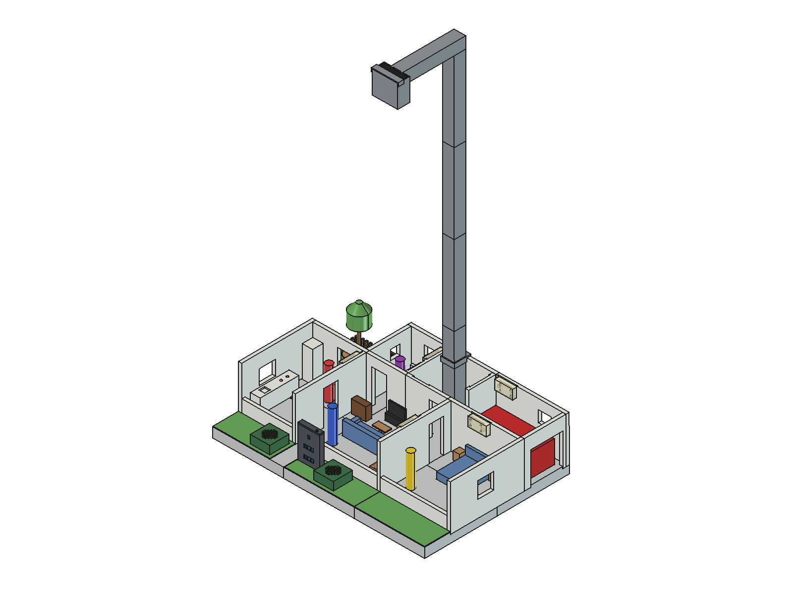
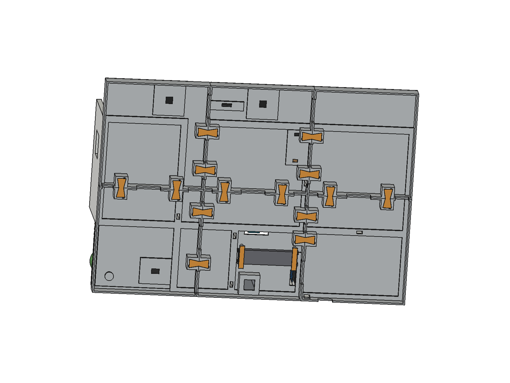
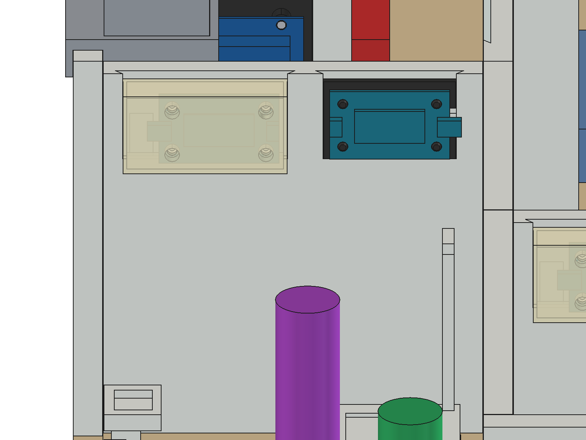
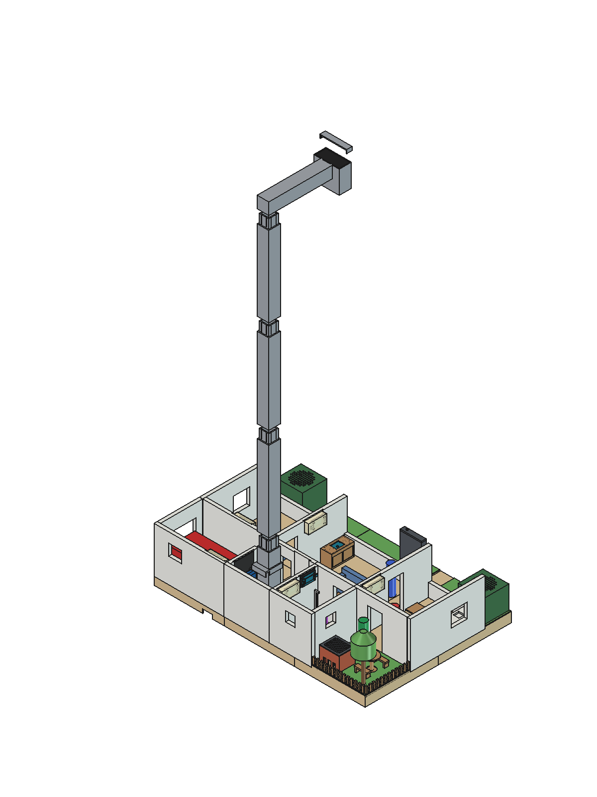
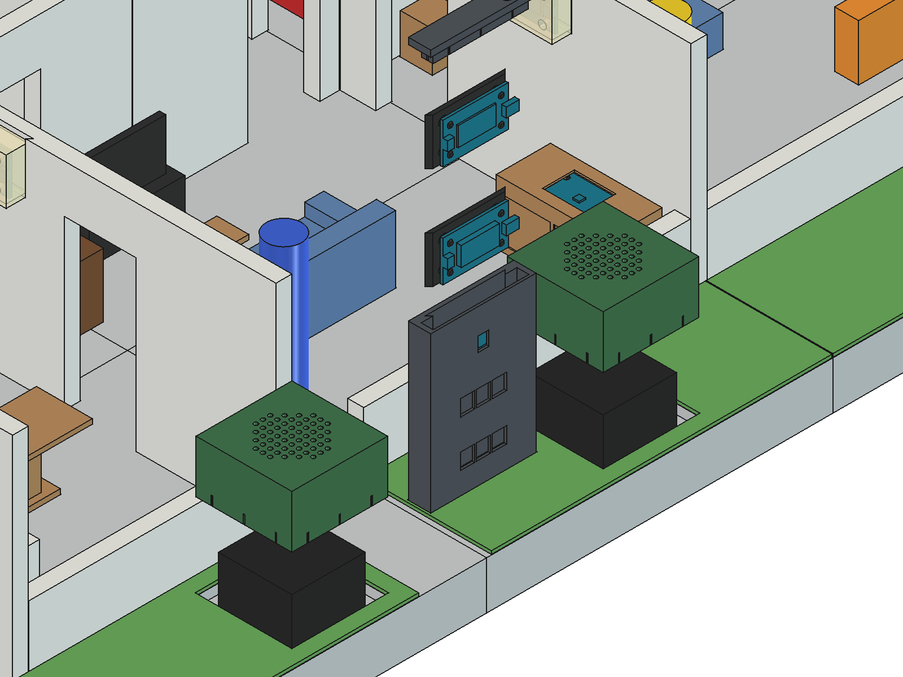

# 3. Stampa e montaggio

La casa si stampa a partire da 84 file STL in `hardware/stl/` (versione 8), distribuiti sotto CC BY 4.0. Il nome di ogni file comincia con un numero da 01 a 59, nell'ordine di montaggio, e **lo stesso numero è inciso sul pezzo stampato**: sulla faccia interna delle pareti, vicino al bordo inferiore, e sul lato inferiore delle pedane. I pezzi uguali hanno lo stesso numero (per esempio le quattordici chiavi da `07_Chiave_01` a `07_Chiave_14`, o i segmenti del palo da `20_Palo_2` a `20_Palo_4`).

*Le immagini di questo capitolo sono della versione precedente dei pezzi: vi compaiono i muri ancora separati e il totem vecchio. Numeri e nomi delle tabelle sono quelli della versione 8.*

Nei nomi dei file compaiono alcune abbreviazioni: *Fac* facciata, *Sx* sinistra, *Dx* destra.

In questa guida il **davanti** è il lato del vialetto, dove stanno i visitatori, e **sinistra** e **destra** si intendono guardando la casa da davanti: cucina e giardino sono a sinistra, camera e garage a destra. Il repository contiene solo i file STL, senza profili per lo slicer. Il colore nelle tabelle è quello previsto per la stampa.

## I pezzi

### Base

| N. | File | Pezzo | Colore |
|---|---|---|---|
| 01–06 | `01_Pedana_A1` … `06_Pedana_B3` | le sei pedane che formano la base (650 × 450 mm con il vialetto), in due file da tre. Sotto le due fioriere le pedane 1 e 2 sono aperte (resta un bordo di 2 mm): le casse passano dal basso. Nella pedana 2 c'è la presa del totem, con il foro per lo spinotto del microfono lavalier | grigio chiaro |
| 07 | `07_Chiave_01` … `07_Chiave_14` | quattordici chiavi a farfalla che bloccano le pedane tra loro da sotto | qualsiasi |
| 08 | `08_Staffa_Revodok_1`, `_2` | due staffe che tengono l'hub USB-C UGREEN Revodok nel suo alloggiamento sotto la base | qualsiasi |
| 09 | `09_Staffa_Scheda_Audio_1`, `_2` | due staffe che tengono la scheda audio USB sotto la pedana 2 (pensate per una scheda di 60 × 22 × 12 mm) | qualsiasi |
| 10 | `10_Fermacavo_1`, `_2` | due fermacavi sotto la pedana 2 per i cavi delle casse (un fascio fino a 8 mm) | qualsiasi |

### Pareti

Le pareti sono alte 135 mm sopra il pavimento; le facciate di cucina, soggiorno e camera sono alte 46 mm, così la webcam riesce a guardare dentro le stanze sul davanti. I muri che si toccano per una faccia intera sono uniti in un solo pezzo, da stampare in piedi (tutti entro 250 mm); porte e finestre vanno a ponte, il portone del garage (100 mm) va stampato con i supporti.

| N. | File | Pareti | Colore |
|---|---|---|---|
| 11 | `11_Parete_Cucina` | la cucina chiusa: parete esterna sinistra, parete verso il giardino (con la porta del giardino), parete verso il soggiorno (con una porta e la luce della cucina) e facciata | bianco |
| 12 | `12_Parete_Camera` | la camera chiusa: parete esterna destra, parete verso il garage (con la luce della camera), parete verso il soggiorno (con una porta e la luce del soggiorno) e facciata | bianco |
| 13 | `13_Parete_Bagno_Tecnico` | il fronte a T di bagno e locale tecnico: le pareti verso il soggiorno, ognuna con una porta, e quella tra bagno e locale tecnico (luce del bagno e Thermo). È largo 249,5 mm: si stampa senza brim | bianco |
| 14 | `14_Parete_Bagno` | parete posteriore del bagno e parete tra giardino e bagno | bianco |
| 15 | `15_Parete_Tecnico` | parete posteriore del locale tecnico e parete tra locale tecnico e garage | bianco |
| 16 | `16_Parete_Garage` | parete posteriore del garage (luce del garage) e parete esterna destra, con il portone del garage | bianco |
| 17 | `17_Parete_Fac_Soggiorno` | facciata del soggiorno; lo spazio tra la cucina e questa facciata è la porta d'ingresso | bianco |

### Palo della webcam

| N. | File | Pezzo | Colore |
|---|---|---|---|
| 18 | `18_Palo_1` | segmento inferiore del palo, che sale dal locale tecnico | grigio |
| 19 | `19_Collare_Palo` | collare attorno al palo, all'altezza della cima delle pareti | grigio |
| 20 | `20_Palo_2`, `_3`, `_4` | i segmenti superiori del palo, con una finestra da 20 × 20 mm da cui passa il cavo USB della webcam | grigio |
| 21 | `21_Braccio_Camera` | il braccio in cima, che termina con la culla della webcam; il cavo passa dal palo nel braccio | grigio |
| 22 | `22_Fermo_Camera` | il fermo che tiene la Logitech C270 nella culla | grigio |

### Placche per l'elettronica

| N. | File | Sostiene | Colore |
|---|---|---|---|
| 23 | `23_Placca_UNO_Q` | la Arduino UNO Q, a pressione su quattro perni, senza viti | nero |
| 24 | `24_Placca_Hub`, `24_Placca_Relay` | il Modulino Hub e il Modulino Latch Relay | nero |
| 25 | `25_Placca_Thermo_Bagno` | il Thermo del bagno | nero |
| 33 | `33_Credenza_Termostato` | la credenza del soggiorno, con sopra il Thermo del termostato | legno |
| 34 | `34_Placca_Termostato` | la placca del Thermo del termostato, dentro la credenza | nero |

### Luci

| N. | File | Stanza | Colore |
|---|---|---|---|
| 26 | `26_Applique_Pixels_Bagno`, `_Camera`, `_Cucina`, `_Soggiorno` | applique che ospitano un Modulino Pixels in bagno, camera, cucina e soggiorno | traslucido |
| 27 | `27_Applique_Pixels_Garage` | applique del garage | traslucido |

### Totem del citofono e casse

| N. | File | Pezzo | Colore |
|---|---|---|---|
| 28 | `28_Totem_Scocca` | la scocca del totem del citofono sul vialetto | antracite |
| 29–31 | `29_Totem_Tasto_A`, `30_Totem_Tasto_B`, `31_Totem_Tasto_C` | i tre tasti del totem | bianco, giallo, blu |
| 32 | `32_Totem_Coperchio_Cappucci` | il coperchio del totem con i cappucci dei tasti: il modulo Buttons si aggancia ai suoi perni | antracite |
| 44 | `44_Fioriera_Cassa_Sx`, `_Dx` | le due fioriere che coprono le casse, a sinistra e a destra del totem, con una scanalatura per il cavo | verde scuro |

### Giardino ed esterni

| N. | File | Pezzo | Colore |
|---|---|---|---|
| 35 | `35_Griglia_Barbecue` | il barbecue; dentro va la ventola | mattone |
| 36 | `36_Basetta_Barbecue` | la basetta del barbecue | arancione traslucido |
| 37 | `37_Griglia_Coperchio` | il coperchio del barbecue | antracite |
| 38, 39 | `38_Albero_Tronco`, `39_Albero_Chioma` | tronco e chioma dell'albero | legno scuro, verde |
| 40 | `40_Tavolo_Giardino` | tavolo da giardino | legno |
| 41 | `41_Panca_Giardino_1`, `_2` | due panche | legno |
| 42, 43 | `42_Staccionata_Sx`, `43_Staccionata_Retro` | staccionate a sinistra e sul retro del giardino | legno |
| 45 | `45_Prato_Giardino` | prato del giardino | verde |
| 46–48 | `46_Prato_Vialetto_Sx`, `47_…_Centro`, `48_…_Dx` | i tre prati del vialetto | verde |

### Arredi

| N. | File | Stanza | Colore |
|---|---|---|---|
| 49 | `49_Arredo_Cucina_Bancone` | bancone della cucina | bianco |
| 50 | `50_Arredo_Cucina_Frigo` | frigorifero | bianco |
| 51 | `51_Arredo_Cucina_Tavolo` | tavolo della cucina | legno |
| 52 | `52_Arredo_Divano` | divano del soggiorno | tessuto |
| 53 | `53_Arredo_Tavolino` | tavolino | legno |
| 54 | `54_Arredo_Mobile_TV` | mobile TV | nero |
| 55 | `55_Arredo_Letto` | letto | tessuto |
| 56 | `56_Arredo_Comodino_Sx`, `_Dx` | comodini | legno |
| 57 | `57_Arredo_Bagno_WC` | WC | bianco |
| 58 | `58_Arredo_Bagno_Lavabo` | lavabo | bianco |
| 59 | `59_Arredo_Bagno_Doccia` | doccia | bianco |

## Colori

Il riconoscimento confronta ogni immagine con una foto della casa vuota, quindi non richiede colori particolari per pareti o arredi. Quello che conta è il contrasto di ciò che si muove: un personaggio di un colore molto vicino al pavimento grigio, alle pareti o ai prati si vede male, e la casa lo segnala quando lo registri (vedi il [capitolo 7](07-riconoscimento-e-identita.md#avvisi)).

La webapp disegna la piantina con i colori di riferimento salvati in `data/house.json`: bianco per bancone, frigorifero, WC e lavabo, marrone legno per tavoli, credenza e comodini, blu per divano e letto, grigio scuro per il mobile TV e il totem, rosso mattone per il barbecue, verde per l'albero e verde scuro per le fioriere. Nei render le applique sono in un materiale traslucido, così i Pixels possono illuminare attraverso.

## Montaggio

I render in `docs/images/render/` mostrano ogni passaggio.

1. **Base.** Appoggia le sei pedane capovolte, controlla i numeri incisi e premi le quattordici chiavi negli alloggiamenti a farfalla a cavallo delle giunture. Inserisci l'hub Revodok nel suo alloggiamento e bloccalo con le due staffe `08`; sotto la pedana 2 monta la scheda audio con le staffe `09` e fissa i cavi delle casse con i fermacavi `10`.

   

2. **Prati.** Gira la base e appoggia al loro posto il prato del giardino e i tre prati del vialetto.
3. **Pareti.** Infila le pareti nelle loro scanalature, seguendo la tabella qui sopra e i numeri incisi. La porta d'ingresso è lo spazio tra la cucina `11` e la facciata del soggiorno `17`; il portone del garage è nella parete `16`.
4. **Placche e luci.** Monta i moduli sulle loro placche e i Pixels nelle applique, poi appendili alle pareti indicate sopra (quale modulo va dove è spiegato nel [capitolo 4](04-collegamenti.md)). Il Thermo del bagno e la luce del bagno condividono la parete tra bagno e locale tecnico, nel pezzo `13`. La UNO Q entra a pressione sui perni della sua placca `23`.

   

5. **Palo e webcam.** Pianta il segmento inferiore `18` nel locale tecnico, infilaci il collare `19`, impila i segmenti da `20_Palo_2` a `20_Palo_4` facendo passare il cavo USB della webcam dalle loro finestre, e aggiungi il braccio `21`. Metti la C270 nella culla e chiudila con il fermo `22`. Secondo i dati della casa l'obiettivo sta a 930 mm sopra il pavimento, sopra il centro della base: la calibrazione si adatta a piccole differenze, ma l'intera base deve essere inquadrata.

   

6. **Totem e casse.** Metti i tre tasti `29`–`31` nel coperchio `32`, aggancia il modulo Buttons ai perni del coperchio e chiudilo sulla scocca `28`; lo spinotto del microfono lavalier passa dalla presa della pedana 2. Infila le casse dal basso, attraverso le pedane 1 e 2, e coprile con le fioriere `44`.

   

7. **Arredi e giardino.** Sistema gli arredi, la credenza con il termostato, il barbecue con la ventola, l'albero, il tavolo, le panche e le staccionate.

Una volta calibrata la casa (vedi il [capitolo 5](05-collaudo.md#9-calibrazione-della-webcam)), gli arredi devono restare dove sono: la casa li considera parte della casa vuota. Se sposti un pezzo, salva di nuovo la casa vuota. Anche la webcam non deve muoversi; se viene urtata, la webapp chiede una nuova calibrazione.

## Personaggi, animali e l'auto

Le statuine e l'auto sono modelli di terze parti e non sono in questo repository; i link sono sulla pagina del progetto.

La casa non ha bisogno di un modello particolare, ma qualche misura aiuta a sceglierli. Per la correzione della parallasse la visione presume una persona alta circa 90 mm (1,8 m in scala 1:20), un animale di circa 35 mm e un'auto di circa 70 mm. L'auto deve passare dal portone del garage, un'apertura di circa 100 mm, e parcheggia in un'area di 180 × 80 mm dentro il garage. Le statuine funzionano meglio stampate in un solo colore, ben saturo, diverso dal pavimento, dalle pareti e dai prati.

Avanti: [collegamenti](04-collegamenti.md).
