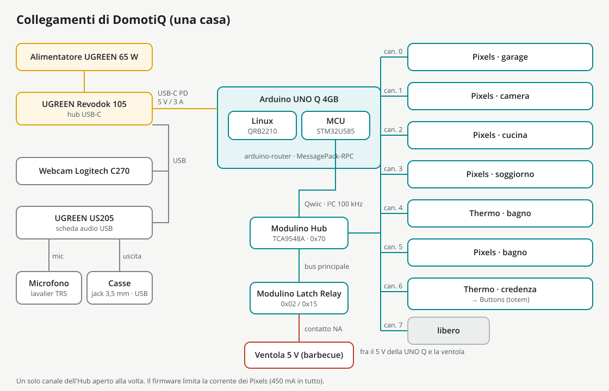

# 4. Collegamenti

Questo capitolo tratta tutto ciò che ha un cavo: la catena dei Modulino sul connettore Qwiic, l'alimentazione dei Pixels, il relè e la ventola del barbecue, l'audio e la webcam.

## Componenti

| Componente | Modello | Note |
|---|---|---|
| Scheda | Arduino UNO Q 4GB | Debian 13 sul Qualcomm QRB2210, microcontrollore STM32U585 |
| Hub USB-C | UGREEN Revodok 105 | alimenta la UNO Q con USB Power Delivery a 5 V / 3 A; sta sotto la base |
| Alimentatore | UGREEN 65 W, 2 × USB-C + 1 × USB-A | alimenta il Revodok |
| Webcam | Logitech C270 | ID USB `046d:0825` |
| Scheda audio | UGREEN US205 | uscita cuffie e ingresso microfono separati |
| Microfono | Neewer lavalier, TRS da 3,5 mm | nel tappo del totem |
| Casse | Goedch, alimentate da USB, jack da 3,5 mm | manopola al massimo: il volume lo gestisce la casa |
| Ventola | 5 V, 40 × 40 × 10 mm | dentro il barbecue |
| Modulino | 5 Pixels, 2 Thermo, 1 Buttons, 1 Latch Relay, 1 Hub | |

## Schema generale



Gli stessi collegamenti in forma di testo:

```
65 W charger ──► Revodok 105 ──► UNO Q (USB-C, Power Delivery 5 V / 3 A)
                     ├── USB ── Logitech C270 (on the pole)
                     └── USB ── UGREEN US205 ── headphone out ──► speakers (3.5 mm jack)
                                            └── mic in ◄── lavalier in the totem cap

UNO Q Qwiic ──► Modulino Hub ──► Modulino Latch Relay          (main bus)
                    ├── ch 0 ── Pixels garage
                    ├── ch 1 ── Pixels bedroom
                    ├── ch 2 ── Pixels kitchen
                    ├── ch 3 ── Pixels living room
                    ├── ch 4 ── Thermo bathroom
                    ├── ch 5 ── Pixels bathroom
                    ├── ch 6 ── Thermo sideboard ──► Buttons
                    └── ch 7 ── free

UNO Q 5 V ──► Latch Relay contact (normally open) ──► fan ──► GND
```

## La catena Qwiic

Il connettore Qwiic della UNO Q è collegato al bus I2C4 dell'STM32U585 (`Wire1` nello sketch): i Modulino li vede solo il microcontrollore. Linux parla con loro attraverso il firmware, passando da `arduino-router`. Il firmware fa girare il bus a 100 kHz (il valore predefinito della scheda è 400 kHz) e scrive a mano ogni transazione I2C, con un'attesa limitata e un controllo del risultato, invece di usare la libreria Modulino.

Il bus principale va dalla UNO Q al **Modulino Hub** e prosegue fino al **Latch Relay**. Tutti gli altri moduli sono appesi a un canale dell'Hub:

| Canale dell'Hub | Modulo | Dove | Indirizzo (7 bit) |
|---|---|---|---|
| bus principale | Modulino Hub (TCA9548A) | sulla sua placca (`24_Placca_Hub`) | 0x70 (cercato tra 0x70 e 0x77) |
| bus principale | Latch Relay | sulla sua placca (`24_Placca_Relay`) | 0x02 o 0x15 (di fabbrica, secondo il lotto) o 0x10 |
| 0 | Pixels | garage, sulla parete posteriore | 0x36 |
| 1 | Pixels | camera, sulla parete verso il garage | 0x36 |
| 2 | Pixels | cucina, sulla parete verso il soggiorno | 0x36 |
| 3 | Pixels | soggiorno, sulla parete verso la camera | 0x36 |
| 4 | Thermo | bagno, sulla parete verso il locale tecnico | 0x44 |
| 5 | Pixels | bagno, sulla parete verso il locale tecnico | 0x36 |
| 6 | Thermo, poi Buttons | credenza del soggiorno, poi il totem sul vialetto | 0x44, 0x3E |
| 7 | libero | | |

La luce del **locale tecnico** non è un modulo: è la matrice di 13 × 8 LED della UNO Q stessa, comandata dal firmware come le altre luci (luce 5 per Linux). La matrice ha un solo colore e 8 livelli: prende effetti e luminosità; il colore si vede sul LED RGB della scheda accanto a lei (LED3).

Note:

- **Stessi indirizzi, canali diversi.** I cinque Pixels rispondono tutti a 0x36 e i due Thermo a 0x44. Non è un problema: il firmware apre un solo canale dell'Hub alla volta.
- **L'indirizzo dell'Hub.** L'Hub risponde a 0x70; la pagina del negozio dice 0x71. All'avvio il firmware cerca in tutto l'intervallo 0x70–0x77, quindi vanno bene tutti e due.
- **L'indirizzo del Latch Relay.** La libreria Modulino gli dà 0x02, il datasheet aggiornato a settembre 2026 dà 0x15 (0x04 e 0x2A nella forma a 8 bit che usano i documenti), quindi dipende dal lotto. Si può anche spostare a 0x10 con il Modulino AddressChanger. Il firmware guarda tutti e tre gli indirizzi, quindi non cambia nient'altro; la **Scansione I2C** mostra quale usa il tuo.
- **Il canale 6 è una catena.** Parte dal Thermo della credenza in soggiorno e prosegue fino al modulo Buttons dentro il totem, appena fuori dalla facciata del soggiorno. C'è un solo modulo Buttons, quindi non serve cambiare nessun indirizzo.
- **L'ordine dei canali.** I numeri delle luci nel firmware seguono i canali dell'Hub: 0 garage, 1 camera, 2 cucina, 3 soggiorno, 4 bagno (il Pixels del bagno sta sul canale 5 perché il canale 4 ospita il Thermo del bagno).
- **Collegare un modulo dopo.** Il firmware cerca i moduli mancanti ogni 5 secondi, quindi un modulo collegato mentre la casa è accesa compare da solo. Un modulo conta come presente solo dopo aver risposto sul bus.

### Il totem

Il totem ospita il modulo **Buttons**; il microfono lavalier sta nel tappo. Visti dal visitatore, i tasti sono, da sinistra: **Parla**, **Citofono**, **Lingua**. I LED gialli del modulo Buttons sono accanto ai tasti, e il totem ha una finestrella per vederli. Se il modulo finisce montato al contrario non serve ricablarlo: scrivi `"buttons": {"reversed": true}` in `var/config/settings.json` e riavvia `domotiq`.

## Alimentazione dei Pixels

Ogni Pixels, a piena luce bianca, può assorbire fino a 264 mA dalla linea a 3,3 V del connettore Qwiic. Cinque arriverebbero a circa 1,3 A, mentre il connettore è dimensionato per 1 A e il regolatore da 2 A della UNO Q alimenta anche il microcontrollore e il Wi-Fi. Per questo il firmware protegge la scheda:

- stima la corrente di ogni fotogramma delle luci (circa 11 mA per canale di colore di ogni LED a piena luminosità);
- quando la stima supera il **budget, 450 mA di serie**, riduce tutte le luci in proporzione;
- in più, limita ogni luce a una **luminosità massima del 30 %** di serie.

Sono valori fissi: non stanno più nelle impostazioni, e la casa li manda al firmware così come sono. Sono volutamente prudenti, perché l'assorbimento reale non è stato misurato con un amperometro.

## Relè e ventola

La ventola del barbecue è una ventola da 5 V, 40 × 40 × 10 mm, comandata dal contatto normalmente aperto del Latch Relay, messo tra il pin 5 V della UNO Q e la ventola:

- il 5 V della UNO Q al morsetto comune del contatto del relè;
- il morsetto normalmente aperto al filo positivo (rosso) della ventola;
- il filo negativo (nero) della ventola al GND della UNO Q.

Prima di collegare, controlla le sigle dei morsetti stampate sul tuo modulo.

Un relè bistabile mantiene la sua posizione anche senza alimentazione. Per questo il firmware lo spegne **a ogni avvio**, e anche ogni volta che Linux resta in silenzio per 30 secondi. Il firmware è compilato con la modalità di avvio "Immediate": parte all'accensione invece di aspettare Linux, così dopo un'interruzione di corrente durante una grigliata la ventola si ferma in pochi millisecondi invece di girare per i 40 secondi che servono a Linux per avviarsi.

Nell'uso normale la ventola gira 20 secondi per ogni grigliata (un'impostazione, da 5 a 120 secondi), mai più di 120 secondi di fila, con una pausa di 30 secondi prima della successiva.

## Audio

- **Scheda audio.** La UGREEN US205 si collega al Revodok. La casa la trova da sola come prima scheda audio USB capace di suonare: la C270 è anche lei una scheda audio USB, ma ha solo il microfono, e l'audio HDMI della UNO Q viene ignorato. A ogni apertura la casa mette l'uscita della scheda a 0 dB, spegne il ritorno del microfono sulle casse e regola il guadagno del microfono (`voice.mic_gain`, 100 %): il volume lo decide la casa in software, con la manopola delle casse al massimo.
- **Casse.** Il loro jack da 3,5 mm va nell'uscita cuffie della US205; l'alimentazione la prendono dalla USB. Gira la loro manopola al massimo e lasciala lì: il volume lo imposta la casa (70 su 100 di serie), e si può cambiare dalla webapp o a voce.
- **Microfono.** Il lavalier Neewer (TRS da 3,5 mm) va nell'ingresso microfono della US205 e sta nel tappo del totem. Registra a 16 kHz mono, solo mentre la casa ascolta; l'audio resta in memoria e non viene mai salvato.

La casa tiene sempre aperto un unico flusso audio in uscita, con un proprio mixer per voce, musica ed effetti sonori, così l'inizio di una frase non viene mai tagliato. Se la scheda audio sparisce o il flusso si ferma, la casa lo riapre e lo segnala nella diagnostica.

## Webcam

La Logitech C270 sta nella culla in fondo al braccio della webcam, guarda dritta verso il basso ed è collegata al Revodok. La casa la trova per nome in `/dev/v4l/by-id`, perché il numero `/dev/videoN` cambia da un avvio all'altro. Usa 1280 × 960 quando la webcam lo offre, altrimenti 1280 × 720, e analizza le immagini a 640 × 480, circa 10 al secondo.

Dopo la calibrazione, esposizione, bilanciamento del bianco e guadagno vengono bloccati, l'antisfarfallio viene impostato a 50 Hz e la compensazione del controluce viene spenta; la casa riapplica queste impostazioni ogni 60 secondi e dopo ogni riconnessione, perché una webcam scollegata le dimentica.

## Percorsi dei cavi

Pianifica i percorsi dei cavi prima di chiudere la casa: dalla UNO Q e dall'Hub alle cinque applique, al Thermo del bagno, alla credenza e poi fino al totem, e dal relè al barbecue in giardino. Misurali sulla tua casa montata prima di comprare i cavi Qwiic, e falli correre lungo le pareti, lontano dalle zone di pavimento che la webcam guarda.

I cavi devono essere Qwiic veri, cioè con il pin 1 collegato al pin 1: i cavi JST-SH a 4 poli generici si vendono anche in versione "inversa" (pin 1 sul pin 4), che mette la massa di un modulo sulla linea dei dati e blocca tutto il bus. Prima di montarli, affianca i due connettori di ogni cavo girati nello stesso modo: i colori dei fili devono essere nello stesso ordine su tutti e due (con fili dello stesso colore, prova la continuità con un tester).

Avanti: [collaudo e messa in servizio](05-collaudo.md).
