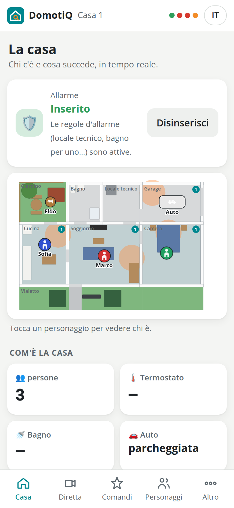
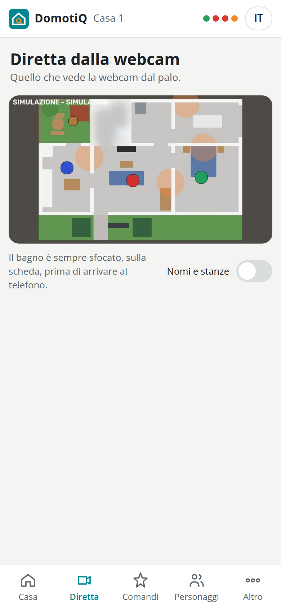
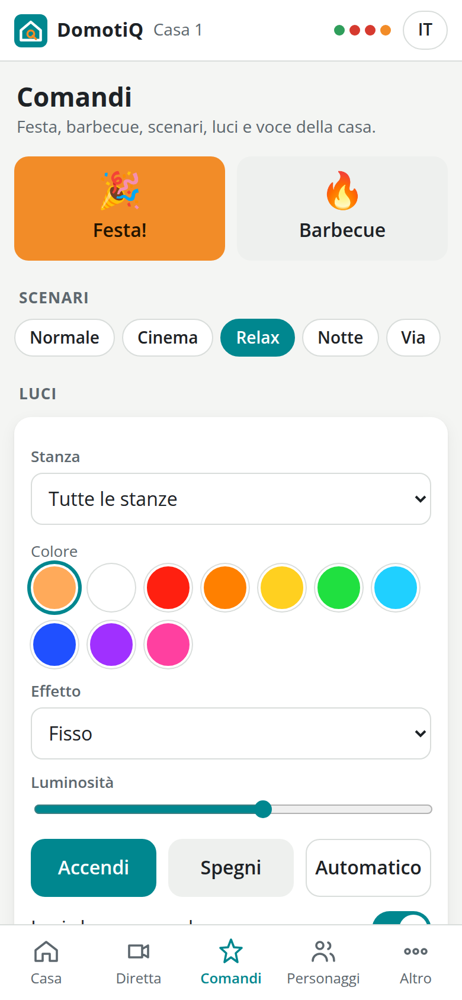
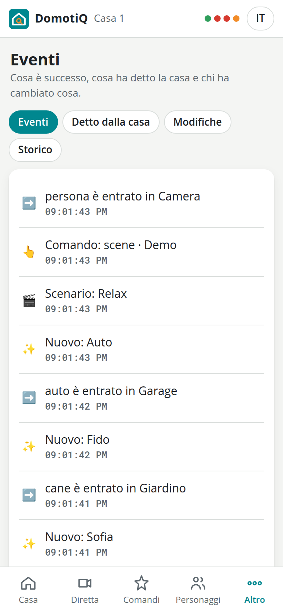
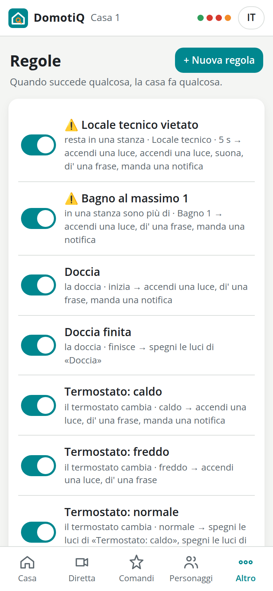
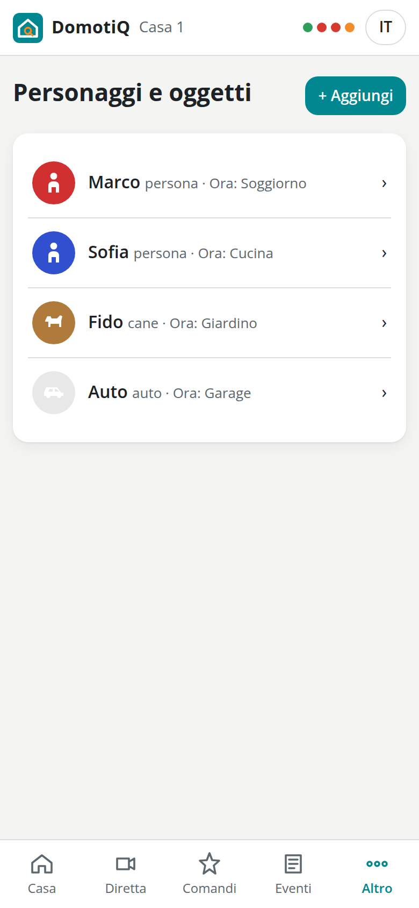
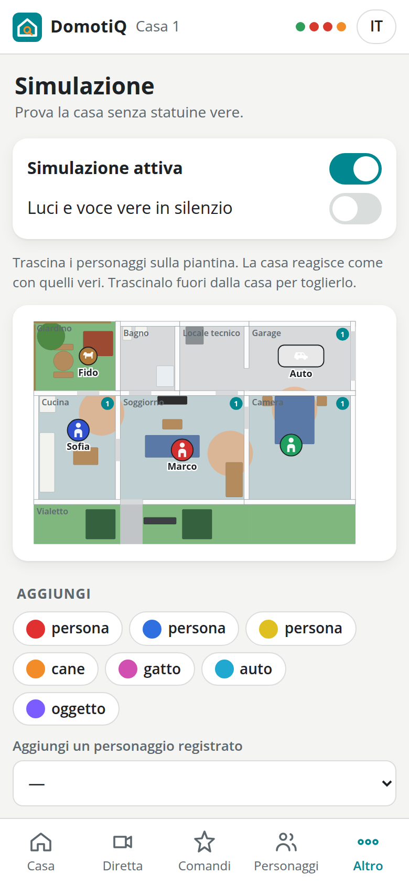
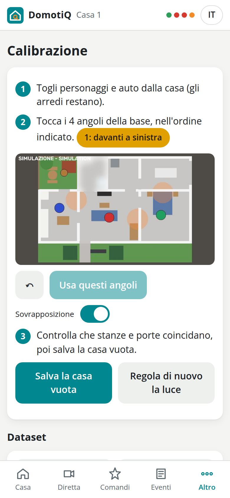
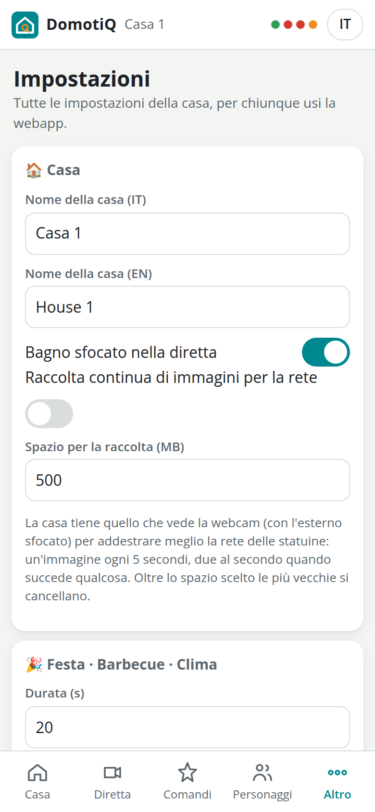

# 6. La webapp

La casa serve la propria webapp direttamente dalla scheda. Non ha bisogno di internet né di installare niente: la apre qualsiasi browser di un telefono collegato al Wi-Fi della casa. È fatta di semplice HTML, CSS e JavaScript senza librerie esterne, è in italiano e in inglese, e ha un tema chiaro e uno scuro che seguono le impostazioni del telefono. Lo stato della casa arriva in tempo reale attraverso un WebSocket, quindi quello che vedi cambia non appena qualcosa si muove nella casa.

## Aprirla

- **Sul Wi-Fi della casa**: sul telefono scegli la rete `DomotiQ-CasaN` e scrivi la password del Wi-Fi (è nel riepilogo dell'installazione e in **Altro → Impostazioni → Wi-Fi della casa**), poi apri `http://10.42.N.1/`. Se il telefono avvisa che la rete non ha internet, scegli *Resta connesso* o *Usa senza Internet*; su Android, se la pagina non si apre, spegni per un attimo i dati mobili. Funzionano anche i nomi `http://casaN.lan/` e `http://casaN.local/`, ma l'indirizzo numerico funziona sempre.
- **Sulla tua rete**: `http://casaN.local/`, con la scheda sul tuo Wi-Fi.
- Sui telefoni la pagina si può aggiungere alla schermata Home; da lì si apre come un'app.
- La prima volta che un telefono la apre, la casa lo saluta a voce e compare una scheda che chiede il nome e invita ad aggiungere un personaggio (vedi il [capitolo 8](08-voce.md#parlare-senza-premere-parla)).
- La webapp usa il semplice `http://`. Non ci sono notifiche di sistema (richiederebbero HTTPS); le foto si scattano con la fotocamera del telefono attraverso il normale selettore dei file, che funziona anche senza HTTPS.

## Chi può fare cosa

Chiunque sia collegato al Wi-Fi della casa può fare tutto, senza PIN né accessi: guardare, comandare, cambiare regole e personaggi, rispondere alle domande della casa, calibrare la webcam, leggere la diagnostica, cambiare le impostazioni, scaricare un backup, riavviare o spegnere la scheda. Le azioni che non si possono annullare (ripristino di un backup, regole di partenza, riavvio, spegnimento, nuova password del Wi-Fi) chiedono prima *Sei sicuro?*.

È voluto: questa è una casa per giocare. Ogni modifica viene registrata con l'ora, il telefono e un soprannome facoltativo (**Altro → Eventi → Modifiche**), e regole e personaggi eliminati restano nel cestino per 24 ore (**Altro → Impostazioni → Cestino**; vedi [Regole](09-regole.md#chi-può-cambiare-le-regole)).

## Cosa hanno in comune tutte le schermate

- **Barra in alto**: il nome della casa, tre pallini di stato (**Microcontrollore**, **Webcam**, **Audio**: verdi quando funzionano, rossi quando no; mentre la simulazione è attiva compare un quarto pallino) e il pulsante **IT / EN**, che cambia la lingua della webapp solo su questo telefono. La prima volta la webapp sceglie la lingua del telefono. La lingua in cui parla la casa è un'impostazione diversa, in **Comandi**.
- **Barra in basso**: **Casa**, **Diretta**, **Comandi**, **Personaggi** (personaggi e oggetti), **Altro**. Ogni pagina scorre fino in fondo, sopra la barra.
- **Ogni pagina comincia allo stesso modo**: il titolo, una riga che dice a cosa serve e, a destra del titolo, la sua azione principale (**+ Aggiungi**, **+ Nuova regola**).
- **Notifiche in cima**, un colore per tipo:
  - **rosso**: un allarme in corso (qualcuno nel locale tecnico), con chi e dove, il pulsante **Disinserisci** che spegne l'allarme come un antifurto, e la **✕**; sulla piantina la stanza lampeggia in rosso;
  - **ambra**: un avviso (troppe persone in bagno, la webcam spostata, la luce della webcam da regolare, il bus dei Modulino bloccato), con la **✕**; sulla piantina la stanza è contornata d'ambra;
  - **grigio**: la connessione con la casa persa (*Connessione con la casa persa: riprovo…*); la webapp si ricollega da sola;
  - **scheda bianca con il bordo verde acqua**: una domanda della casa (*La casa chiede*).

  La **✕** chiude la notifica su tutti i telefoni: un allarme o un avviso torna solo se finisce e si ripresenta; una domanda chiusa sparisce ovunque e la casa smette di ascoltare. I file della webapp si caricano sotto una versione che cambia a ogni aggiornamento: dopo un aggiornamento della casa ogni telefono si ricarica da solo e prende la versione nuova.
- **Domande della casa**: quando la casa non è sicura chiede, per esempio "In soggiorno c'è Viola o Rosaria?", con un pulsante per ogni risposta e, quando i nomi proposti sono più di uno, **Tutti e due** (o **Tutti**): due statuine a contatto sono una sola macchia per la webcam. Può rispondere qualsiasi telefono; vale la prima risposta e la domanda sparisce ovunque. La casa fa la domanda anche ad alta voce e ascolta la risposta da sola, senza il tasto Parla. Quando chiede chi è un nuovo arrivato ci sono anche **Non c'è niente**, un campo per scrivere un nome nuovo, il tipo e il pulsante **Aggiungi** (vedi il [capitolo 7](07-riconoscimento-e-identita.md#un-nuovo-arrivato)).
- **Sottotitoli**: tutto quello che la casa dice compare come sottotitolo in fondo a ogni telefono, anche quando la casa è impostata su *Silenziosa*.
- **Messaggi brevi**: compaiono in basso, con lo stesso colore delle notifiche (un personaggio registrato, la grigliata pronta, la notifica di una regola, l'allarme inserito o disinserito) e si chiudono con un tocco. Quelli di allarme fanno anche vibrare il telefono, dove il browser lo permette.
- **Orologio**: quando la casa non conosce l'ora, il primo telefono che apre la webapp la imposta (*Ora della casa impostata da questo telefono*). Quando la conosce, i telefoni dei visitatori non la toccano più (uno con l'orologio sbagliato la sposterebbe per tutti): la si corregge da **Altro → Impostazioni → Usa l'ora di questo telefono**, oppure a voce.
- **Soprannome**: la prima volta che modifichi una regola o registri un personaggio, la webapp chiede *Come ti chiami? (facoltativo, compare nel registro)*. Puoi cambiarlo in **Altro → Il tuo soprannome**. Ogni telefono ha anche un identificativo automatico.

## Casa



*La casa: chi c'è e cosa succede, in tempo reale.*

**Piantina.** La casa virtuale, ricavata dal modello CAD, con in basso il vialetto, dove stanno i visitatori.

- Stanze, pareti, porte e arredi; ogni luce di stanza brilla con il suo colore e il suo effetto del momento.
- I due termometri, il termostato sulla credenza e quello del bagno, ognuno con la temperatura in gradi Celsius e, sotto, l'umidità (*umidità 45%*); un contatore per ogni stanza in cui c'è qualcuno.
- Ogni personaggio con la sagoma del suo tipo (persona, cane, gatto, animale, auto, oggetto), nel suo colore e con il suo nome; un **?** segna un personaggio su cui la casa non è sicura.
- L'auto, le fiamme sul barbecue quando è acceso, le stanze in allarme in rosso e quelle con un avviso in ambra.

**Com'è la casa.** Schede con le persone presenti, **Termostato** (temperatura in °C, *Umidità* in percentuale, *Climatizzatore acceso* o *Riscaldamento acceso*), **Bagno** (temperatura in °C, *Umidità*, *Doccia in corso*), **Auto** (*appena arrivata*, *parcheggiata*, *appena uscita*, *non c'è*), **Scenario**, e **Festa** e **Barbecue** quando sono in corso.

**Chi c'è.** L'elenco di tutto ciò che la casa vede, con nome (oppure *Ospite* per una persona sconosciuta, *Sconosciuto* per qualsiasi altra cosa), tipo e stanza. Tocca un personaggio, sulla piantina o nell'elenco, per aprire la sua scheda: foto o sagoma, tipo, stanza e, quando c'è un dubbio, *Non sono sicura di chi sia*. **Chi è?** (per uno sconosciuto) o **È un altro: cambia** (per uno riconosciuto male) apre l'elenco di tutti i personaggi e gli oggetti che la casa conosce, con la stanza in cui si trovano adesso, e sotto un nome nuovo con il suo tipo. Scegliendone uno già noto il nome si sposta lì da dov'era, perché un nome non sta mai in due posti, e la casa impara quell'aspetto del personaggio anche se la luce lo cambia molto; con un nome nuovo il personaggio viene registrato con i colori che la casa vede. Se la casa vede qualcosa che non c'è (un riflesso, una luce, un modulo appoggiato), **Non c'è davvero: togli**, dopo una conferma, lo toglie subito dalla casa: la casa lo tratta come un errore della webcam, dimentica quel punto e lì per un po' non fa nascere niente.

**Elemento non riconosciuto.** Sotto la piantina: tocca il pulsante, poi il punto della piantina in cui si trova qualcosa che la casa non segue (una statuina che non ha visto posare, o che ha preso per la casa vuota). Intorno a quel punto la casa riprende la casa vuota com'era salvata, così quello che c'è torna visibile, e lo segue da quel momento; poi chiede chi è, con lo stesso elenco. Se lì non vede niente di diverso dalla casa vuota lo dice: basta spostare un poco l'elemento e riprovare. Con la simulazione attiva il tocco mette lì una statuina virtuale.

**Allarme.** In fondo alla pagina, il riquadro dell'allarme, che si inserisce e si disinserisce come un antifurto:
- **Inserito** (scudo verde): le regole d'allarme (locale tecnico vietato, bagno per uno e quelle che crei tu con *Avviso*) funzionano;
- **Disinserito** (scudo grigio): quelle regole stanno zitte, niente sirena né avvisi; tutto il resto (luci, voce, altre regole) va avanti come sempre;
- **Allarme in corso** (bordo rosso): una regola d'allarme sta suonando.

Il pulsante **Disinserisci** / **Inserisci** cambia lo stato per tutta la casa, con un bip e un messaggio su ogni telefono (*Allarme disinserito da Marco*). Disinserendo, gli allarmi in corso si spengono subito con le loro luci; reinserendo, chi è già in un posto sorvegliato viene notato di nuovo, come se fosse appena entrato. Lo stato resta anche dopo un riavvio.

## Diretta



*Diretta dalla webcam*: l'immagine della webcam, circa 5 fotogrammi al secondo. L'interruttore **Nomi e stanze** scrive il nome e la stanza sopra ogni personaggio. **Elemento non riconosciuto** funziona come sulla pagina della casa, toccando il punto nell'immagine. Sulla scheda, prima che l'immagine arrivi a qualsiasi telefono, viene sfocato tutto ciò che sta intorno alla casa e, di serie, il bagno (vedi **Impostazioni**).

Quando la webcam manca per più di qualche secondo la schermata dice *La webcam non è collegata.*, e la scritta sparisce da sola quando torna; mentre la simulazione è attiva mostra un disegno della casa con la scritta *SIMULAZIONE - SIMULATION*.

## Comandi



- **Festa!**: 20 secondi di musica da ballare composta dal codice stesso della casa, con uno spettacolo di luci su tutti i Pixels. Prima della festa successiva c'è una pausa di 30 secondi.
- **Barbecue** / **Spegni barbecue**: avvia o ferma la ventola del barbecue.
- **Scenari**: Normale, Cinema, Relax, Notte, Via (vedi il [capitolo 9](09-regole.md#scenari)).
- **Luci**: scegli una stanza o *Tutte le stanze*; ogni scelta arriva subito alla casa, senza altri tasti. Un colore tra dieci accende la luce, **A** la restituisce alla casa, il cerchio barrato la spegne; l'effetto (*Fisso*, *Respiro*, *Lampeggio*, *Onda*, *Arcobaleno*, *Scintille*, *Fuoco*) e la luminosità cambiano la luce già accesa. Scegliendo una stanza si vede com'è la sua luce in quel momento. Una luce accesa da qui dura due minuti, spenta resta al buio per un minuto, poi la stanza torna alla casa. L'interruttore **Luci che seguono le persone** attiva o disattiva per tutta la casa le luci che seguono chi si muove.
- **Voce della casa**: **Lingua della casa** (Italiano, English), **Loquacità** (Silenziosa, Normale, Chiacchierona), **Volume**, **Suona il campanello** (avvia la conversazione del citofono come se si fosse premuto il tasto del totem).
- **Domande ai personaggi**: **Fai una domanda** fa fare alla casa, subito, una domanda a un personaggio scelto a caso tra quelli in casa, preferendo quello che di lui non sa ancora (il colore preferito, se ama ballare o le grigliate, il piatto preferito, da dove viene...). La risposta si ascolta senza Parla e resta tra le sue informazioni; poi la casa la usa: la luce del suo colore preferito quando entra in una stanza o con "accendi la luce preferita di Marco", una festa se ama ballare, il barbecue se ama le grigliate (vedi il [capitolo 8](08-voce.md#cosa-sa-dei-personaggi)). Lo stesso pulsante, per un personaggio preciso, è nella sua scheda in **Personaggi**. Funziona anche fuori dalla modalità chiacchierona, ma non in quella silenziosa.
- **Fai dire alla casa**: scrivi una frase e tocca **Fai parlare**: la casa la pronuncia.

Quando un comando non si può eseguire in quel momento (una festa è già in corso, o in pausa), un messaggio dice *Già in corso o in pausa, riprova tra poco*.

## Eventi



Quattro schede:

- **Eventi**: chi è entrato o uscito da quale stanza (persone, animali e l'auto), l'auto, le regole scattate, le notifiche, termostato e doccia, i cambi di scenario e di lingua, i nuovi personaggi, barbecue, festa, e ogni comando arrivato da un telefono, con il soprannome.
- **Detto dalla casa**: ogni frase che la casa ha detto.
- **Modifiche**: il registro delle modifiche. Chi (soprannome oppure *Un telefono*) ha creato, modificato, eliminato o ripristinato quale regola o personaggio, ha cambiato le impostazioni o la calibrazione, con l'ora e l'identificativo del telefono.
- **Storico**: per ogni personaggio, le stanze in cui è passato nelle ultime 24 ore.

La casa conserva gli eventi per 7 giorni e le posizioni per 24 ore.

## Altro

Tutte le altre pagine, in due gruppi, più il tuo soprannome:

- **La casa**: **Eventi**, **Regole**, **Cosa ha imparato**, **Simulazione**, **Informazioni**;
- **Messa a punto**: **Calibrazione**, **Diagnostica**, **Registro della visione**, **Impostazioni**;
- **Tu**: **Il tuo soprannome**, che compare nel registro delle modifiche.

### Regole



L'elenco delle regole, ognuna con un interruttore per attivarla o disattivarla, e il pulsante **+ Nuova regola**. Toccando una regola si apre l'editor Quando / Se / Allora. Tutto sulle regole è nel [capitolo 9](09-regole.md).

### Cosa ha imparato

Le risposte che la casa si è sentita dire, ha immaginato o ha pensato quando non sapeva rispondere (capitolo 8), dalla più recente. Per ognuna la pagina mostra:
- la domanda, e il personaggio, se riguarda qualcuno;
- la risposta;
- se è stata *detta da qualcuno*, *immaginata dalla casa* o *pensata dalla casa*, e quando;
- se riguarda oggi o domani: *vale fino a domani*.

**Modifica** apre la risposta.
- **Salva.** Si possono correggere la risposta e la domanda sentita male ("come si fa la vita" invece di "come si fa la pizza"): da quel momento la casa dice quella corretta, come se gliel'avesse insegnata qualcuno.
- **Dimentica.** La cancella.

Ogni modifica va nel registro delle modifiche.

### Personaggi e oggetti



L'elenco dei personaggi, degli animali, delle auto e degli oggetti registrati, con foto o sagoma, tipo, e dove si trovano adesso (*Ora: Cucina*, oppure *Non lo vedo*). **+ Aggiungi** avvia la registrazione guidata; toccandone uno si apre la sua scheda, dove puoi cambiare **Nome**, **Tipo**, **Pronuncia inglese (facoltativa)** e **Chi è (per le storie)** (una cosa per riga, come la si direbbe dopo il nome: *fa il medico*, *ama il jazz*, *ha paura dei ragni*; la casa le usa nelle storie e nelle risposte, vedi il [capitolo 8](08-voce.md#storie-ricordi-e-domande-libere)), oppure eliminarlo con **Elimina** (resta nel cestino per 24 ore). Vedi il [capitolo 7](07-riconoscimento-e-identita.md).

### Simulazione



Personaggi virtuali da trascinare sulla piantina al posto delle statuine vere, sensori virtuali (temperatura e umidità del termostato e del bagno) e i tre tasti del totem (**Parla** si tiene premuto come sul totem). Chiunque può attivarla o disattivarla. **Luci e voce vere in silenzio** tiene tranquilla la casa vera mentre fai le prove. Finché la simulazione è attiva, la casa ignora la webcam. Per togliere un personaggio virtuale, trascinalo fuori dalla casa.

### Calibrazione



I quattro angoli della base (dopo **Usa questi angoli** la casa regola da sola la luce e salva la casa vuota), il controllo della sovrapposizione, **Regola la luce e salva la casa vuota** e **Salva solo la casa vuota**. La casa vuota non si salva se la sala è troppo buia, né se la casa vede ancora delle statuine: le nomina e chiede se salvare comunque (per qualcosa che non è una statuina). Mentre la casa lavora, una finestra con una rotellina dice cosa sta facendo e i pulsanti restano bloccati, così un'operazione non parte due volte; alla fine compare il risultato (vedi il [capitolo 5](05-collaudo.md#9-calibrazione-della-webcam)). In fondo ci sono gli strumenti per i dataset: **Cattura**, **Raffica (10)**, **Registra una sequenza (60 s)** e **Scarica il dataset** (vedi il [capitolo 7](07-riconoscimento-e-identita.md#dataset-e-registrazioni)).

### Diagnostica

Si aggiorna ogni pochi secondi:

- **Scheda**: nome host e versione, tempo di attività, carico e temperatura della CPU, memoria, disco libero, numero di client Wi-Fi, orologio e provenienza dell'ora, dispositivo audio, voce (riconoscimento vocale e modello linguistico), webcam (dispositivo, fotogrammi al secondo, tempo di elaborazione di un'immagine e come si divide tra segmentazione, riconoscimento e resto, *da calibrare*, *spostata, rifare la calibrazione*).
- **Modulino**: lo stato del collegamento con il microcontrollore, la versione del protocollo del firmware, e un pallino verde o rosso per ogni modulo.
- Pulsanti: **Scansione I2C** (gli indirizzi che rispondono su ogni canale dell'Hub), **Prova audio**, **Prova microfono (3 s)**, **Scarica i registri** (mostra le ultime 500 righe del log dell'applicazione e le salva in un file).

### Registro della visione

Ogni presenza nuova annunciata, ogni nome dato e ogni macchia scartata dalla rete delle statuine, con la sua immagine, dalla più recente (le ultime 600). Per ognuna: **Giusto**, oppure **Era…** con il personaggio giusto o "niente (non è una statuina)". Le risposte diventano esempi verificati per il prossimo addestramento della rete (vedi il [capitolo 7](07-riconoscimento-e-identita.md#la-rete-che-conosce-le-statuine)). Le immagini rispettano la sfocatura di quello che sta fuori dalla casa e, se attiva, del bagno.

### Impostazioni



- **Casa**: il nome della casa in italiano e in inglese; **Tasti montati al contrario**, per un totem montato al rovescio; **Bagno sfocato nella diretta**, acceso di serie.
- **Luci · Festa · Barbecue · Clima**: *Luminosità massima (%)*, *Limite di corrente dei Pixels (mA)*, *Luminosità delle luci che seguono*, *Spegnimento dopo (s)*, *Colore delle luci che seguono*, **Luce del colore preferito di chi entra** (nello scenario Normale la luce di una stanza prende il colore preferito di chi c'è, se l'ha detto alla casa), la *Durata (s)* della festa (10–60), *Durata della ventola (s)* (5–120), *Caldo: aumento sul riferimento (°C)*, *Doccia: aumento di umidità (%)*. Poi **Salva**. Luminosità e limite di corrente arrivano subito al microcontrollore.
- **Voce**: **Saluta i telefoni nuovi**, **Domande ai personaggi (modalità chiacchierona)** e *Una domanda ogni (s)* (vedi il [capitolo 8](08-voce.md#parlare-senza-premere-parla)); **Attivazione con la parola chiave** e *Parola di attivazione* (per esempio *Casa*): detta la parola, la casa fa quello che fa il tasto Parla (vedi il [capitolo 8](08-voce.md#la-parola-di-attivazione)). Salvando, sotto compare come la casa sentirà la parola (*Robot 3* diventa *robot tre*; *Domotiq*, che il riconoscimento vocale non conosce, si sente come «domotica»). Se ci sono parole che il riconoscimento non riesce a sentire in nessun modo, compaiono anche quelle.
- **Ora**: l'ora del telefono e **Usa l'ora di questo telefono**, che imposta l'orologio della casa.
- **Wi-Fi della casa**: il nome della rete e la *Password del Wi-Fi* (da 8 a 63 caratteri). **Salva**, dopo *Sei sicuro?*, la scrive nell'hotspot; se l'hotspot è acceso riparte dopo un paio di secondi e tutti i telefoni, compreso il tuo, vanno ricollegati con la password nuova. Annotala: serve a ogni telefono che entra nella rete.
- **Backup**: **Scarica il backup** (uno zip con regole, personaggi con le loro foto e impostazioni; mai la rete, il nome della casa o la calibrazione della webcam), **Ripristina da un backup** (sostituisce regole, personaggi e impostazioni), **Regole di partenza** (sostituisce tutte le regole con quelle con cui la casa è partita).
- **Cestino**: regole e personaggi eliminati nelle ultime 24 ore, ognuno con **Ripristina**.
- **Sistema**: **Riavvia l'app**, **Riavvia la scheda**, **Spegni la scheda**, ognuno dopo *Sei sicuro?*.

### Tabellone

Non è nel menu: si apre scrivendo `/board` dopo l'indirizzo della casa. Mostra la piantina, la diretta, l'ultima frase detta e gli ultimi eventi, per un monitor o un tablet accanto alla casa, e non ha comandi.

### Informazioni

Che cos'è il progetto, la riga dei crediti e le licenze di voci e modelli.

## Provare la webapp su un PC

L'intera casa gira su un PC in simulazione, senza nessun hardware. Da una copia del repository:

```bash
python3 -m venv .venv
.venv/bin/pip install -r requirements.txt
PYTHONPATH=src .venv/bin/python -m domotiq --simulate
```

Poi apri `http://localhost:8080/`. La casa tiene i suoi dati in `var/` dentro la cartella del repository.

## Per i maker: le API

| Metodo e percorso | Uso |
|---|---|
| `GET /api/state` | lo stato completo |
| `WS /ws` | lo stato completo alla connessione, poi ogni cambiamento, le domande e i sottotitoli |
| `GET /api/stream` | diretta (MJPEG) |
| `GET/POST/PUT/DELETE /api/rules` | regole |
| `GET/PUT/DELETE /api/identities` | personaggi |
| `GET /api/knowledge`, `PUT/DELETE /api/knowledge/{id}` | quello che la casa ha imparato: elenco, correzione (`{"answer": ..., "question": ...}`), cancellazione |
| `POST /api/commands/{name}` | party, grill, grill_stop, scene, light, lights_off, lights_auto, language, verbosity, volume, follow, intercom, say, alarm (`{"armed": false}` disinserisce l'allarme) |
| `POST /api/confirm/{id}` | risposta a una domanda della casa (`{"value": ...}`; `{"together": [...]}` per *tutti e due*, `{"nothing": true}` per *non c'è niente*) |
| `POST /api/time` | ora da un telefono (solo se la casa non la conosce) |
| `POST /api/clock` | ora dalle impostazioni |
| `GET/PUT /api/settings` | impostazioni |
| `GET /api/diagnostics` | diagnostica |
| `POST /api/vision/{name}` | calibrazione: corners, adjust, empty, capture, record |
| `GET /api/events` | eventi |

Avanti: [riconoscimento e identità](07-riconoscimento-e-identita.md).
